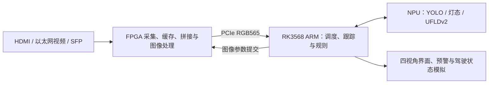

# RoadFusion-Edge

基于紫光同创 FPGA 与 RK3568 ARM/NPU 的四视角辅助驾驶演示系统。

FPGA 负责视频采集、拼接、图像处理和 PCIe 传输；RK3568 NPU 运行目标、交通灯和车道模型，ARM 完成跟踪、规则判断、界面显示与驾驶状态模拟。当前板端源码入口为 **[board_v12](board_v12/CURRENT.md)**。

[板端使用说明](board_v12/CURRENT.md) · [PCIe DMA-BUF + RGA 图像路径](board_v12/docs/PCIE_RGA_PREVIEW.md) · [双板 FPGA 工程](fpga/dual_board/README.md) · [Windows 视频上位机](tools/udp_video_sender/README.md) · [同步验证记录](board_v12/docs/BASELINE_SYNC_20261029.md)

## 当前版本

2026-10-29 已从 RK3568 板端同步 `board_v12`：PCIe 实时输入固定为**驱动 8.2 DMA-BUF + 同步 RGA**，非 RGA 功能同步板端 `board_v11.before-new-baseline-20261027-195936` 基线。`board_v10`、`board_v9`、`board_v8` 等目录保留历史版本。

| 模块 | 当前功能与状态 |
| --- | --- |
| 四视角显示 | PCIe 原始槽序左/前/右/后；检测、HSV、运动参考与车道 ROI 共用同一相机映射；标题栏放大、视角切换与 Z 键 |
| 实时图像通路 | FPGA RGB565 → 驱动 8.2 DMA-BUF → 同步 RGA 转 BGR888；预览缩放与 YOLO/MO/UFLDv2 前处理同样走 RGA |
| 测试一：交通灯 | 用途车道匹配灯态，左/直/右方向和行驶/停止按钮，红灯优先报警 |
| 测试二：车道控制 | 前视 UFLDv2 本车道，实虚线区分，左/右变道、保持直行、强制实线变道报警 |
| 测试三：导航 | 右上模拟方向与距离输入，结合灯态给出建议；视频导航 OCR 尚未接入 |
| 测试四：模拟停车 | 多个危险目标分别标红，持续确认安全后自动解除模拟刹车；起步仍手动，默认关闭 |
| 前向碰撞预警 FCW | 独立开关、小号估计距离、柔和绿/黄/红车道覆盖及顶部碰撞等级 |
| 图像参数控制 | 预设、详细参数、草稿/应用和 RECEIVED/APPLIED 两阶段回执状态 |

自动车道偏离报警 LDW 已关闭，测试一与强制实线变道报警保留。后向 RCW 基础逻辑保留、默认关闭；盲区联动暂未启用。所有行驶、转向和停车行为均为界面模拟。

## 数据链路



详细板间连接与模式切换见 [双板系统说明](fpga/dual_board/README.md)。

## 板端快速启动

使用已匹配的 PCIe 驱动与 FPGA 位流，在 RK3568 上准备模型及运行依赖后执行：

```sh
cd /home/cat/rk3568_adas/board_v12
cmake -S . -B build -DCMAKE_BUILD_TYPE=Release
cmake --build build --target adas_four_view -- -j1
export DISPLAY=:0
export XAUTHORITY="$HOME/.Xauthority"

# 开启前视车道与 FCW
sh scripts/run_pcie.sh --enable-lanes --enable-fcw
```

`run_pcie.sh` 会先调用 `scripts/prepare_pcie.sh`：已加载驱动 8.2 时直接复用，未加载时核对版本与内核后按需编译加载，再检查 PCIe/RGA 权限及 NPU 驱动。普通启动默认关闭车道和 FCW，可在界面开启。测试四通过 `--enable-test4` 或其界面开关启用；行驶/停止按钮继续使用原测试一控件。文件回放、依赖和模型目录约定见 [board_v12 使用说明](board_v12/CURRENT.md)。

## 当前模型

| 用途 | 部署文件 | 精度与推理位置 |
| --- | --- | --- |
| 道路目标定位 | `yolo14_960x544_qat_int8.rknn` | 960×544，QAT INT8，NPU |
| 交通灯形状/颜色 | `mo_fp16_baseline.rknn` | 128×128，FP16，NPU |
| 前视车道几何 | `ufldv2_culane_res18_1600x320_int8.rknn` | 1600×320，原始 INT8 部署模型，NPU |

UFLD 未切换为新续训 QAT 候选。模型 SHA256 见 [模型清单](board_v12/config/model_manifest.json)，训练与转换记录见 [UFLDv2 QAT 说明](training/UFLDV2_QAT.md)。RKNN 是部署格式，INT8 是量化精度，QAT 是训练方式。

车道效果同时受原始模型输出、输入裁剪和几何门限影响。前广角与前长焦需要分别验证；长焦不是只替换文件路径即可完成适配。当前两路对比结果和调整方向见 [相机输入与车道适配](board_v10/docs/CAMERA_INPUTS.md)（该文档随 board_v10 记录保留）。

## 工程入口

| 内容 | 入口 |
| --- | --- |
| 当前 RK3568 程序、驱动源文件与配置 | [board_v12](board_v12/CURRENT.md) |
| PCIe DMA-BUF + RGA 图像与预览路径 | [PCIE_RGA_PREVIEW.md](board_v12/docs/PCIE_RGA_PREVIEW.md) |
| 驱动自动准备与启动调整 | [STARTUP_20261029.md](board_v12/docs/STARTUP_20261029.md) |
| 基线同步与验证记录 | [BASELINE_SYNC_20261029.md](board_v12/docs/BASELINE_SYNC_20261029.md) |
| 前向 FCW 规则与显示 | [FCW.md](board_v10/docs/FCW.md) |
| 测试四多人标红、停车与自动解除 | [TEST4.md](board_v12/docs/TEST4.md) |
| 模拟导航 | [NAVIGATION_DEMO.md](board_v12/docs/NAVIGATION_DEMO.md) |
| FPGA 图像参数窗口与回执 | [PCIE_V3_IMAGE_CONTROLS.md](board_v12/docs/PCIE_V3_IMAGE_CONTROLS.md) |
| 板卡一：采集、三路融合、KEY2 四宫格切换 | [工程及调试 bit](fpga/dual_board/board1_capture/README.md) |
| 板卡二：DDR 图像处理、光口与 PCIe 输出 | [工程及协议说明](fpga/dual_board/board2_sfp_pcie/README.md) |
| Windows 视频/图片 UDP 发送上位机 | [udp_video_sender](tools/udp_video_sender/README.md) |
| 独立 PCIe 采集与控制工具（驱动 7.0） | [pcie_v2](tools/pcie_v2/README.md) |
| 独立 PCIe 采集查看器（驱动 8.2，DMA-BUF + RGA 预览缩放） | [pcie_v4](tools/pcie_v4/README.md) |

板卡一的最新融合/四宫格集成版已有工程 ZIP 与调试 bit，物理时序和上板验收限制见其说明；板卡二的位流与 ARM 回执协议须配套。应用回归通过不等于 FPGA 链路和全部位流已完成板级验收。

## 验证与素材

2026-10-29 上传 board_v12 前，板端 ARM64 完整构建通过（`sh scripts/build.sh`），14 项回归全部通过；真实 RGA 遍历 65536 种 RGB565 值转 BGR/RGB 最大通道误差 0；PCIe 实机采集短测 30 帧正常退出，采集设备已释放。边界：该短测为无窗口运行，**未做完整交互/GLES 窗口测试，未复测长时间性能与模型准确率**，短测 FPS 不作为视频性能结论。记录见 [基线同步与验证](board_v12/docs/BASELINE_SYNC_20261029.md)。

行人横穿、前后车接近和车道素材独立保存。PC FP32 素材回放、板端 RKNN INT8 验证与实时性能测量分别记录；几何有效率不等于模型准确率，单目距离和相对速度也不是有真值验证的精确测量。

模型、原始视频、训练集、下载缓存及编译产物不随本次源码上传。当前相机输入、模型文件和有效证据不满足条件时，不能据此认定道路安全。

## 历史版本

历史模型、版本沿革、PC 工具和 FPGA 整合记录见 [项目历史说明](docs/PROJECT_HISTORY_20261026.md)。历史文档的“当前版本”以对应记录日期为准。

仓库中的第三方材料保留其原有许可与权利边界，见 [免责声明与权利通知](fpga/dual_board/DISCLAIMER.md)。
