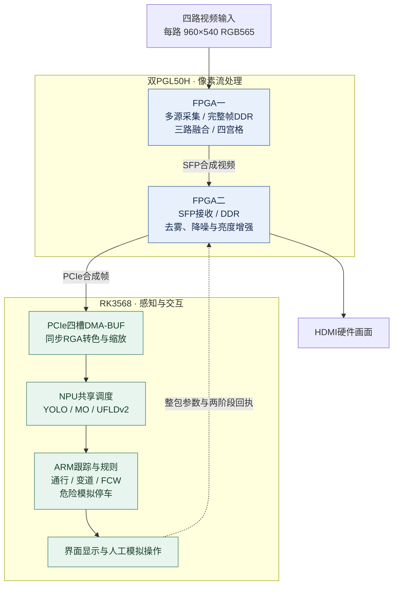

# RoadFusion-Edge 紫光智瞳异构融合辅助驾驶系统

基于双紫光同创 PGL50H FPGA 与 RK3568 ARM/NPU 的多视角辅助驾驶演示系统。以**多视角并行处理、软硬件异构协同、复杂环境图像增强**为主要特点，连接四路视频采集、三视角融合、图像增强、道路感知与预警显示。

[板端部署](board_v12/README.md) · [当前版本与默认设置](board_v12/CURRENT.md) · [双板连接与工程](fpga/dual_board/README.md) · [文档导航](docs/README.md) · [架构与流程图](docs/DIAGRAMS.md) · [性能与验证](docs/PERFORMANCE.md)

## 系统组成

| 单元 | 平台 | 任务 |
| --- | --- | --- |
| 采集与融合 | PGL50H / MES50HP 板卡一 | HDMI、两路以太网及 SFP 视频接入，DDR 完整帧管理，三路 LUT 融合与四宫格切换 |
| 增强与传输 | PGL50H / MES50HP 板卡二 | 单路 HDMI 回传、SFP 合成视频接收，DCP 去雾、亮度降噪、Gamma、CLAHE及高光保护，HDMI/PCIe 输出 |
| 感知与交互 | 野火鲁班猫2 / RK3568 | DMA-BUF/RGA 图像适配，NPU 目标、灯态与车道推理，ARM 跟踪、规则和交互 |



图中四路输入的物理来源及板卡二HDMI经SFP回传的连接，详见[双板数据流图](fpga/dual_board/README.md#数据流与输入映射)。实线表示视频/处理数据流，虚线表示参数控制；控制链路不输出真实车辆执行命令。

四路输入各为 960×540 RGB565，合成输出为 1920×1080；三路前景融合区为 1920×540，下半区居中保留后视。PCIe 向 ARM 交付一张合成图，各路画面由应用按映射提取。完整帧管理保证读写页面一致性，不代表四路曝光同步。

## 当前版本

说明整理于 **2026-11-03**，以主分支最近功能提交 [`06da0df`](https://github.com/istiurosmadelgordont-cloud/RoadFusion-Edge/commit/06da0df8d50c750740f39de7f4c898eb1ea183f5)（2026-10-31）为代码基线。

| 组件 | 当前入口 | 版本说明 |
| --- | --- | --- |
| RK3568 应用 | [board_v12](board_v12/CURRENT.md) | 10月31日同步界面、融合布局、控件、启动脚本及 AVM 工具；PCIe 固定 driver 8.2 + DMA-BUF + 同步 RGA |
| 板卡一 | [board1_capture](fpga/dual_board/board1_capture/README.md) | `board1_canvas_sfp_20261030.zip` 及配套 bit/FIC |
| 板卡二 | [board2_sfp_pcie](fpga/dual_board/board2_sfp_pcie/README.md) | `sfp_ddr_image_pice_handshake_tested_20261030.zip`；bit 实际生成日期为10月18日 |
| 视频发送 | [udp_video_sender](tools/udp_video_sender/README.md) | Windows 视频/图片/彩条 UDP 发送器 |
| 独立预览与调参 | [pcie_v4](tools/pcie_v4/README.md) | driver 8.2、DMA-BUF/RGA 预览；不运行识别模型 |

当前应用只有 `board_v12`；旧应用通过 Git 历史查看。FPGA 早期基线及工具对照版本仍留在各子目录，其适用范围见 [工程导航](fpga/README.md) 和 [工具导航](tools/README.md)。

## 功能与边界

| 功能 | 当前行为 |
| --- | --- |
| 多视角显示 | 四路均分、主视角优先、单路放大、融合布局；ARM 布局须与 FPGA 实际输出匹配 |
| 路口通行 | 人工选择用途车道及模拟行驶方向，匹配灯态，提示红停绿行及违规操作 |
| 车道与变道 | 前视 UFLDv2 车道几何、实虚线证据、强制实线变道报警；证据不足不放行 |
| 车道保持辅助开关 | 默认关闭；结合车道检测控制前视偏离提醒，不输出转向控制 |
| FCW | 独立开关，显示本车道目标的估计距离与风险等级 |
| 危险模拟停车 | 连续危险新观测触发，多目标标红；连续安全新观测后解除，起步仍由人工操作 |
| 模拟导航 | 方向与距离人工输入，结合灯态给出建议；未接入视频导航 OCR、地图定位 |
| 图像增强调参 | 草稿编辑、显式应用、整包参数、帧边界生效及两阶段回执 |
| AVM | 使用特定本地素材及标定的鸟瞰演示，与 FPGA 三视角融合分开管理 |

行驶、转向及停车均为界面模拟，未连接真实车辆执行器；未接入 CAN 实测车速。单目距离与接近时间为演示估计，不作为精确测距结果。

## 板端快速启动

先准备配套 FPGA 位流、模型和 RK3568 Linux 运行环境。在板端将下列路径替换为实际部署位置：

```sh
cd /path/to/RoadFusion-Edge/board_v12
sh scripts/build.sh
export DISPLAY=:0
export XAUTHORITY="$HOME/.Xauthority"
sh scripts/run_pcie.sh

# 开启车道检测和FCW
sh scripts/run_pcie.sh --enable-lanes --enable-fcw
# 开启危险模拟停车
sh scripts/run_test4.sh --enable-lanes
```

`run_pcie.sh` 自动准备/复用 PCIe 驱动8.2与权限，默认打开模拟导航页、关闭车道检测和TTC；FCW和测试四默认关闭。车道检测与“车道保持辅助”偏离提醒是两个开关。启动脚本在条件允许时尝试将 NPU 最低频率恢复至800 MHz，失败则打印提示。依赖、模型位置、多设备和回放方式见 [板端使用说明](board_v12/README.md)。

## 模型与性能

| 模型 | 当前部署 | 输入与精度 |
| --- | --- | --- |
| 14类道路目标 YOLO | `yolo14_960x544_qat_int8.rknn` | 960×544，QAT INT8 |
| MO 灯态细分类 | `mo_fp16_baseline.rknn` | 128×128，FP16 |
| UFLDv2 前视车道 | `ufldv2_culane_res18_1600x320_int8.rknn` | 1600×320，原始部署 INT8；未选用续训 QAT 候选 |

模型由共享 NPU 调度，多个软件任务不等于多模型同时并行推理。哈希见 [模型清单](board_v12/config/model_manifest.json)，训练资料见 [训练导航](training/README.md)。模型、视频、训练集和构建产物另行准备。

用户技术文档记录：无 NPU 预览采集约60 FPS、识别开启后显示约10～20 FPS、YOLO更新约4 FPS；秒表拍照法的总显示时差无 NPU 约140 ms、识别开启约300 ms。这些数字对应技术文档中的测试配置，不能作为所有位流、场景和开关组合的保证；来源、版本差异、资源及时序范围见 [性能与验证记录](docs/PERFORMANCE.md)。

## 工程资料

- [板端架构](board_v12/ARCHITECTURE.md)与[PCIe/RGA路径](board_v12/docs/PCIE_RGA_PREVIEW.md)
- [双板系统](fpga/dual_board/README.md)与[图像参数协议](board_v12/docs/PCIE_V3_IMAGE_CONTROLS.md)
- [当前版本与分支](docs/VERSIONS.md)、[历史资料索引](docs/HISTORY.md)
- [第三方材料权利说明](fpga/dual_board/DISCLAIMER.md)
