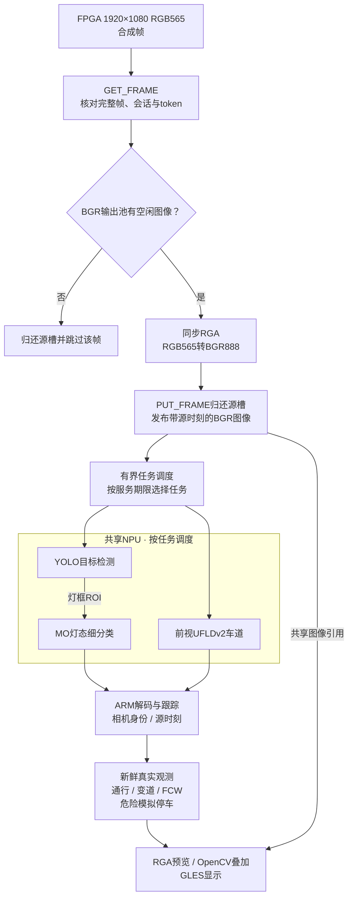

# board_v12 软件架构

适用当前主分支，整理于2026-11-03。实时FPGA输入已经接入，使用PCIe驱动8.2、DMA-BUF和同步RGA；早期“仅文件模拟、FPGA待接入”的九层表已不适用。

## 数据与任务分工

图中是处理与调度关系；采集与显示可独立推进，NPU模型任务受共享执行约束。源槽与BGR图像的寿命不同，详见[缓冲流程](../docs/DIAGRAMS.md#缓冲区所有权与图像寿命)。

模型共享NPU执行资源，软件工作线程不代表YOLO、MO和UFLD在硬件上同时推理。调度按服务期限限制待处理工作，YOLO与灯态细分成组完成；结果带源时刻与相机身份，规则使用新鲜真实观测，跟踪预测用于显示连续性。

## 模块入口

| 层次 | 文件 | 职责 |
| --- | --- | --- |
| 采集与设备控制 | [pcie_capture.hpp](include/adas/pcie_capture.hpp)、[driver](driver/) | 设备会话、完整帧、token、STOP、参数回执 |
| 图像适配 | [pcie_rga.hpp](include/adas/pcie_rga.hpp)、[rga_image_ops.hpp](include/adas/rga_image_ops.hpp) | 同步RGA转色/缩放、有界输出池 |
| 相机与显示映射 | [camera_slot_order.hpp](include/adas/camera_slot_order.hpp)、[camera_view_layout.hpp](include/adas/camera_view_layout.hpp) | 源象限到front/rear/left/right，四路/优先/单路/融合显示 |
| 感知与调度 | [perception_schedule.hpp](include/adas/perception_schedule.hpp)、[npu_executor.hpp](include/adas/npu_executor.hpp) | 目标和车道任务安排、结果时效 |
| 模型 | [rknn_detector.cpp](src/rknn_detector.cpp)、[lamp_classifier.cpp](src/lamp_classifier.cpp)、[ufld_lane_detector.cpp](src/ufld_lane_detector.cpp) | YOLO14类、MO9类、UFLDv2解码 |
| 跟踪与规则 | [signal_demo.hpp](include/adas/signal_demo.hpp)、[lane_signal_simulator.hpp](include/adas/lane_signal_simulator.hpp)、[test4_safety.hpp](include/adas/test4_safety.hpp)、[fcw_monitor.hpp](include/adas/fcw_monitor.hpp) | 用途车道选灯、实虚线变道、危险模拟停车、FCW |
| 导航与AVM | [navigation_demo.hpp](include/adas/navigation_demo.hpp)、[avm_renderer.hpp](include/adas/avm_renderer.hpp) | 人工导航输入、特定素材鸟瞰 |
| 界面与集成 | [four_view.cpp](src/four_view.cpp)、[roadfusion_dashboard.inc](src/roadfusion_dashboard.inc)、[gl_presenter.cpp](src/gl_presenter.cpp) | 控件、状态、叠加与GLES呈现 |

## 缓冲与生效语义

源DMA槽只保持至同步RGA读取结束，以完整token归还；普通BGR/RGB输出由引用计数保护到最后消费者结束。池满跳过输入，不覆盖在用图像。`--pcie-buffers`控制应用输出池，不改变硬件四槽。

参数走独立控制线程：五字配置形成完整快照，cookie关联RECEIVED与APPLIED。APPLIED表示FPGA入口帧边界应用，不等于显示器已呈现对应图像；超时保留事务，不无条件重发。见 [参数协议](docs/PCIE_V3_IMAGE_CONTROLS.md)。

## 功能范围

车道保持辅助开关默认关闭，只门控前视偏离提醒；车道检测与测试二变道规则独立。导航为人工方向/距离输入，AVM依赖特定素材和标定。源端三路融合在FPGA计算，ARM融合布局负责重组显示。CAN、真实车辆控制、视频导航OCR与通用在线相机标定均未接入。

当前功能与默认值以 [CURRENT.md](CURRENT.md) 为准；新开发遵循 [工程约定](ENGINEERING.md)。
