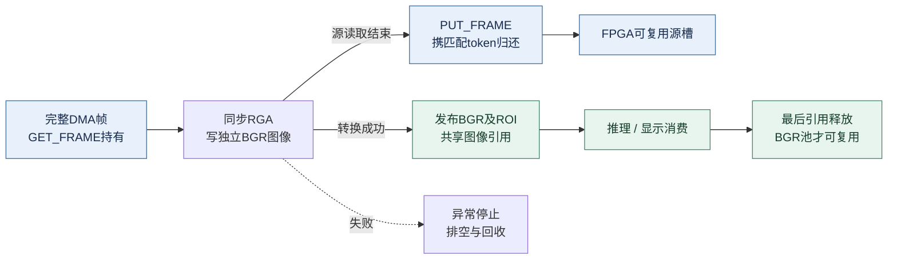

# 架构与流程图

图示按2026-10-31主分支及10月30日双板归档说明整理，更新于2026-11-03。实线表示视频或处理数据流，虚线表示控制/生命周期关系；图示不新增功能或验证结论。

| 图 | 阅读位置 | 重点 |
| --- | --- | --- |
| 整机分工 | [根README](../README.md#系统组成) | 双FPGA像素流与RK3568感知交互 |
| 双板视频流 | [双板说明](../fpga/dual_board/README.md#数据流与输入映射) | 两个SFP方向、四路来源与两级显示 |
| ARM感知流水 | [板端架构](../board_v12/ARCHITECTURE.md#数据与任务分工) | 同步RGA、共享NPU及ARM后处理 |
| FPGA图像增强 | [板卡二说明](../fpga/dual_board/board2_sfp_pcie/README.md#图像增强与旁路) | Y通道多级处理、色度/参考对齐及RGB旁路 |
| 参数生效时序 | [参数说明](../board_v12/docs/PCIE_V3_IMAGE_CONTROLS.md#寄存器与回执) | cookie、跨域握手、RECEIVED与APPLIED |
| DMA/BGR寿命 | 本页下图 | 源槽归还与消费者释放分别管理 |

## 缓冲区所有权与图像寿命

图中上支路表示源槽归还，下支路表示独立图像消费。若BGR池满，不访问像素并归还本次源槽；RGA失败时停止采集并排空回收。

源DMA槽在同步RGA结束后即可归还；独立BGR图像必须等推理、ROI和显示的最后一个消费者释放后才可复用。四个源槽与应用BGR输出池是不同层次，`--pcie-buffers`不改变FPGA槽数。图中是正常交付及转换失败的简化流程，STOP、会话切换和旧token拒绝以驱动实现为准。

## 阅读边界

- 四路并行采集不代表相机曝光同步，也不代表三个模型同时在NPU执行。
- ARM融合布局只组织已有画面；空间融合由FPGA计算，KEY2模式与界面需人工匹配。
- 模拟导航、行驶、转向和停车均是应用状态，没有车辆执行控制链。
- 图像增强可配置不代表各级默认开启；时序、性能与模型准确率仍按[性能记录](PERFORMANCE.md)的来源分别判断。

历史测试二设计图仍留在[原计划](test2_adas_plan.md)，不与当前实现图混用。
