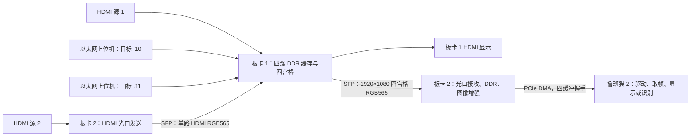

# 双板四路采集、光口互传与 PCIe 输出

2026-09-27 根据两份本地工程的当前顶层接线整理。最新版上位机随本说明发布；两份 FPGA 工程已在本地完整整理，但其厂商 IP、配置和工程材料的公开再分发授权尚未确认，当前仓库未上传这两份新工程。下面的 PDS、RTL 和握手文档路径指本地整理目录中的文件，不能用仓库旧快照代替。
## 工程入口

| 设备 | 工程 | 顶层 | 作用 |
| --- | --- | --- | --- |
| 板卡 1 | `board1_capture/3_ddr_test.pds` | `test_ddr`，`source/ddr_test_top.v` | 四路缩放/接收、DDR 缓存、四宫格显示，光口发送合成视频 |
| 板卡 2 | `board2_sfp_pcie/hdmi_ddr_pice.pds` | `hdmi_ddr_pcie`，`source/hdmi_ddr_pcie.v` | HDMI 经光口送给板卡 1；接收板卡 1 合成视频，经 DDR、增强、PCIe 送鲁班猫 2 |
| Windows PC | [以太网上位机](../tools/udp_video_sender/README.md) | `app.py`，双击 `start.cmd` | 视频/图片/彩条转换为 RGB565，通过 UDP 送板卡 1 |

两个 PDS 文件记录的工具版本均为 **PDS 2022.2-SP6.4**，器件 **PGL50H / FBG484 / -6**。使用相应版本打开各自 PDS 文件，执行 Compile、Synthesize、布局布线、时序检查和 Generate Bitstream，再分别下载到对应板卡。

## 双向数据流



两个光口方向承担不同内容：板卡 2 发出的是自身 HDMI 输入；板卡 1 回传的是四路拼接后的单帧。返回链路没有四个独立 PCIe 视频流，ARM 按象限切分同一张 1920×1080 图像。光口使用工程内自定义 8b/10b 视频协议，不是光纤以太网或 UDP。

## 板卡 1 当前四路映射

每个象限为 960×540 RGB565，合成尺寸为 1920×1080。顶层参数 `ZOOM_VIDEO_LENGTH/ZOOM_VIDEO_HIGTH` 为 960/540，`VIDEO_LENGTH/VIDEO_HIGTH` 为 1920/1080。

| DDR 通道 | 当前输入 | 主要信号 | 显示位置 |
| --- | --- | --- | --- |
| 0 | 板卡 1 HDMI，经 `video_zoom` | `hdmi_ddr_de`、`hdmi_ddr_vs`、`zoom_data_out` | 左上 |
| 1 | 板卡 2 HDMI 经 SFP 接收，再缩放 | `hdmi_sfp_ddr_de`、`post_frame_vsync`、`zoom_sfp_data_out` | 右上 |
| 2 | 以太网口 0 | `eth0_rx_de/vs/data` | 左下 |
| 3 | 以太网口 1 | `eth1_rx_de/vs/data` | 右下 |

本地目录名包含 `ov5640`，工程也保留 OV5640 配置和采集模块；但是当前顶层通道 2 的 CMOS 接线被注释，通道 3 接以太网口 1。因此当前快照是 **HDMI + SFP + 双以太网**。若需要 OV5640 作为一路输入，应另外调整顶层接线，不能仅按目录名判断已启用。

通道 0 已有 HDMI 隔帧写入逻辑，60 Hz 输入时每两帧取一帧，平均写入约 30 fps。通道 1 也存在隔帧 DE 逻辑，但当前 `video1_vs_in` 仍连接原始 `post_frame_vsync`，生成的 `hdmi_sfp_ddr_vs` 未接到该端口；这点按原样保留，调试帧复位和采样率时需注意。隔帧降低平均流量，不会降低保留帧内部的像素瞬时速率。

## 接线与启动顺序

1. 板卡 1、板卡 2 分别下载对应工程生成的位流，确认 DDR 初始化成功。两个原工程的下载文件不能混用。
2. 两块板卡的 SFP 建立双向连接：板卡 1 TX 接板卡 2 RX，板卡 2 TX 接板卡 1 RX。当前顶层使用 `i_p_l2rx* / o_p_l2tx*`，具体物理插座按各自 FDC 和板卡丝印核对。
3. HDMI 源分别连接两块板卡的 HDMI IN。板卡 1 HDMI OUT 可用于直接检查四宫格。
4. 电脑千兆网卡接板卡 1 对应以太网口，按下节设置静态邻居映射，再运行上位机。
5. 板卡 2 PCIe 接鲁班猫 2 的兼容 RC 接口。先确认 PCIe 枚举，再加载与四缓冲握手协议匹配的驱动，登记 DMA 缓冲并启动取帧。

板卡 2 的 SFP 物理收发器已经接入修改后的 PCIe IP：`source/hdmi_ddr_pcie.v` 使用 `pcie_test` 的 `sfp_*` 端口，SFP 编解码模块使用其 fabric 接口。不能直接用原始 PCIe IP 覆盖本目录的修改版，也不能额外实例化一个竞争同一物理 HSST 资源的收发器。保留两端 IP 配置、字对齐和 K 码协议一致。

## 以太网发送参数

| 板卡 1 接口 | 目标 IPv4 | 目标 MAC | 默认 UDP 目标端口 |
| --- | --- | --- | --- |
| 以太网 0 / DDR 通道 2 | `192.168.1.10` | `A0-B1-C2-D3-E4-E4` | `1234` |
| 以太网 1 / DDR 通道 3 | `192.168.1.11` | `A0-B1-C2-D3-E1-E1` | `1234` |

最新版上位机支持本机 IP 下拉/手填与刷新、目标 IP/MAC 设置、输入/输出分辨率和帧率、帧头到尺寸包的 VS 消隐间隔、UDP 像素负载和包间隔。对当前 FPGA，**输出仍设为 960×540**；输入视频可以是其他分辨率，上位机会缩放。改界面输出尺寸不会自动改 FPGA。

在 `tools/udp_video_sender` 的管理员 PowerShell 中执行，示例本机地址为已配置到相应网卡的 `192.168.1.102`：

```powershell
powershell -NoProfile -ExecutionPolicy Bypass -File .\configure_network.ps1 -LocalIP 192.168.1.102 -TargetIP 192.168.1.10 -TargetMAC A0-B1-C2-D3-E4-E4
```

第二路使用 `.11 / A0-B1-C2-D3-E1-E1`，`LocalIP` 选择实际连接该口的网卡地址。两个独立直连网卡若配置在同一子网，需要确认 Windows 路由选择正确；本程序绑定源 IP，不能把静态 ARP 当成路由配置。也可在合适的千兆交换网络中，用同一网卡向两个不同目标发包。

双击 `start.cmd`，首次启动安装 Python 依赖。单个窗口同时只发送一个目标；双路测试运行两个窗口，分别填写两组目标。建议先用 960×540、10 fps、120 Mbps、256 B 像素负载、20 us 最小包间隔、2 ms VS 消隐验证，再根据 DDR/FIFO 波形调整。两窗口会共同占用主机和网络资源。

每帧的 UDP 负载顺序：`F0 5A A5 0F` 帧头包 → 等待 VS 消隐 → `03 C0 02 1C` 尺寸包 → 恰好 1,036,800 字节大端 RGB565 像素。停止会发送完当前帧；无 ACK、包序号和重传，本地显示已提交不等于 FPGA 确认接收。

## 板卡 2 到鲁班猫 2

板卡 2 光口接收信号 `post_frame_vsync/de/rgb` 写 DDR，输出经 `video_enhance` 后交给 `pcie_dma_ctrl`。当前控制器标记为 `PCIE_HS_20260919`，默认 1080p RGB565、64 字节图像 Payload、64,800 个图像包。

必须由 RC 管理四个 DMA 图像缓冲和独立状态区：配置地址 → START → 等待帧尾 token → 消费图像 → RELEASE(token)。四个槽都未归还时，FPGA 跳帧；停止使用 STOP(cookie) 并等待匹配应答。寄存器和内存布局见本地 `board2_sfp_pcie/docs/RC_HANDSHAKE_GUIDE.md`，`rc/handshake_reference.h` 是适配参考，不是完整内核驱动。

仓库已有 [board_v8 PCIe 实时输入说明](../board_v8/PCIE_INPUT.md)，应用把左上/右上/左下/右下解释为前/后/左/右。实际视频接线应与这个语义一致。**board_v8 依赖 HS2 ioctl 驱动；仓库原 `tools/pcie_hdmi_host_system/driver` 是较早版本，不能默认认为 ABI 匹配。** 本次整合没有替换鲁班猫内核驱动，也不宣称下载后即可完成整个识别链路。

## 本地快照与验证范围

- 来源：用户指定的 `hdmi ethernet ov5640 sfp ddr hdmi/board_3_oneboard_design`、`sfp_ddr_pice_handshake`，以及 `Documents/ChatGPT/ethernet` 最新上位机。
- 本地快照采用普通目录保存，可直接比较和修改；保留 RTL/IP 原始编码和换行。`SOURCE_MANIFEST.csv` 记录各工程文件 SHA-256。
- 包含源码、IP 配置/实现、PDS、约束、板卡 2 的握手说明/参考代码/测试；排除编译缓存、日志、临时文件、历史 IP 备份和生成位流。PDS 中的构建输出路径可由重新编译生成。
- 原始 README 保留为 `README.original.md`。板卡 2 的 `BUILD_STATUS.md` 是 2026-09-19 历史验证记录，不能当作本次修改后光口/PCIe 整体的验证结果。
- 本次核对两个 PDS 的设计输入引用，板卡 1 共 139 个、板卡 2 共 174 个，均存在；运行上位机 23 项单元测试通过。
- 本次未重新执行 PDS 全编译、时序签核或双板/鲁班猫实测。此前 FIFO 满写、帧复位、读写页切换与长期稳定性仍需针对当前位流验证，不能由归档操作推定已解决。

第三方 IP 和例程的版权/授权声明在本地保留原样。公开仓库本次仅更新上位机、本文和根目录 README；本地 FPGA 快照内的源码、IP、工程配置、清单及板卡文档均尚未随本次发布。
