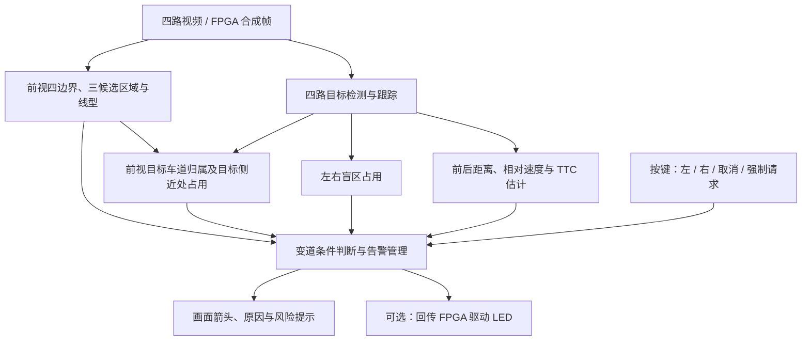
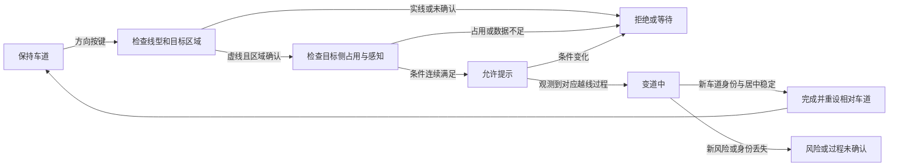

**测试二：三车道感知、多视角变道辅助与碰撞预警方案**

设计日期：2026-10-15；实施更新：2026-10-16。本文保留功能方案与验收目标，下文“待完成”列属于设计阶段记录；实际已接入的功能、板端运行方法、按键与验证范围以 [测试二实施记录](https://github.com/istiurosmadelgordont-cloud/RoadFusion-Edge/blob/a6ab14ee72b9bc163f0428a35f9c44413b2e2eaa/board_v8/TEST2_START.md) 为准。QAT 训练及候选对照见 [QAT 记录](../training/UFLDV2_QAT.md)。

项目定位：基于 FPGA 与 RK3568 的四视角 ADAS 演示系统。前视识别本车道及左右相邻候选车道，判断前方目标所属车道；左右视角识别目标侧盲区，后视补充后车接近预警；按键输入行驶意图，经融合判断后，用画面箭头和报警展示结果。车辆行为以画面或 LED 模拟。

**界面与交通灯逻辑保留约束（2026-10-20 用户确认）**

测试二及后续车道检测、防抖、虚实线识别优化继续保留现有四宫格和测试一交通灯交互：用途车道选择（左转车道／直行车道／右转车道）、左转／直行／右转模拟方向按钮、车辆行驶／停止状态指示，以及图形叠加与 HSV 复核开关。方向按钮维持当前单击切换行为：点击方向开始模拟行驶，再次点击同一方向停止；行驶／停止栏维持状态指示用途。

保留按用途车道匹配控制灯组、红绿灯的新鲜观测确认、红灯下模拟行驶报警、绿灯下方向不匹配报警和灯态未知时不提示通行的逻辑。交通灯的用途车道与测试二的左／右变道意图分别处理；车道显示保持、卡尔曼滤波与线型显示缓冲不参与交通灯通行授权。

本次按用户提供的三车道参考画面细化方案：复用已有四边界、三候选区域及中心短箭头，补充车道状态、目标归属、目标车道占用和变道过程定义。参考画面只用于明确展示目标，其中的 ACC、LK、加速度等文字不作为本项目已实现功能。

测试二的展示主线定为：**实线保持车道 → 虚线请求变道 → 盲区判断 → 输出方向提示 → 强制实线变道请求报警**。碰撞预警、相对测速作为同一界面的扩展功能。

题面截图明确允许“图像叠加”或“LED 指示”两种方式。首版采用图像叠加完成方向输出，LED 作为可选硬件联动，不把 LED 设为首版必须完成项。

**功能范围与现有基础**

| 功能 | 预期展示 | 当前本地代码基础 | 方案中仍需完成的工作 |
| --- | --- | --- | --- |
| 三车道检测 | 最多四条边界、左邻/本车道/右邻区域、本车道中心短箭头及偏离方向 | `LaneResult` 已保存四条边界和三个区域，已有相邻区域显示 | 核对外侧边界稳定性，区分完整区域、候选区域与未知区域 |
| 虚实线识别 | 左虚右实等左右独立结果 | 已沿车道曲线采样白/黄像素并做时序确认 | 检验阴影、遮挡、远近变化下的分类；识别不足时及时回到未知 |
| 前方车辆车道归属 | 车辆标记为左邻、本车道、右邻、跨线或未确认 | 已有检测框、跟踪 ID 和三车道多边形；尚未形成完整三车道目标管理 | 增加接地点归属、跨线处理和时序确认，分别选择本车道前车与目标车道关注车辆 |
| 按键方向意图 | 左变道、右变道、取消请求 | 现有界面按钮可模拟左/右转向意图 | 增加赛题演示按键与实体按键映射，统一接入同一请求接口 |
| 变道辅助 | 可变道、暂勿变道、条件未确认及具体原因 | `LaneChangeFsm` 已检查线型、转向意图和侧视数据 | 增加目标车道几何与近处占用检查、强制请求事件、新鲜观测确认与完成判据 |
| 左右盲区 | 左右独立占用提示；请求向占用侧变道时升级告警 | 已有左右 `BlindSpotMonitor` | 现有区域是图像 ROI；需按所用相机核对区域和检测能力 |
| 实线强制请求报警 | 红色提示“实线禁止变道”，禁止输出变道允许箭头 | 普通非虚线请求已有拒绝原因 | 增加强制请求输入、独立告警事件及保持/取消逻辑 |
| 前向碰撞预警 FCW | 锁定前车，显示估计距离、接近速度、TTC 与风险颜色 | `RiskEstimator` 已存在并接入四路主流程 | 核对真实触发素材、估计尺度与报警阈值 |
| 后车接近预警 RCW | 后车持续接近时提示风险 | 已有后视风险估计 | 可作为扩展演示，不能仅以“后方有车”作为危险依据 |
| 测速 | 首版显示“相对接近速度（估计）” | 当前依据连续目标距离变化估算相对速度 | 本车时速另接 CAN、轮速或可用定位数据；演示注入值标记来源 |
| LED 指示 | LED0 左变道，LED1 保持车道，LED2 右变道 | 本次核对的主流程未见测试二专用 LED 联动 | 若选做，增加 ARM→FPGA 状态回传、引脚与异常复位联调 |

“代码存在”表示可以复用模块，不等于选定场景已通过验收。现有虚实分类是沿曲线的像素规则，并非已验证的独立线型识别网络；盲区占用也尚不代表经过实车标定的物理危险范围。

**按 ADAS 功能项细化**

功能名称、计算指标和输入能力分别定义：FCW/RCW/BSD/LDW 等是功能，TTC/TLC/THW 是供功能使用的时间指标。用户提到的 `TTL` 暂待含义确认；本版同时写入碰撞时间 TTC 与压线时间 TLC，不将 TTL 自行扩展成一个已确定的功能名。

常见含义参考：FCW、LDW 见 [Mobileye 功能术语](https://ims.mobileye.com/fleets/us/resources/qna/)，BSD 及转向请求时的升级告警见 [Bosch 盲区检测](https://www.bosch-mobility.com/en/solutions/assistance-systems/blind-spot-detection/)，RCW 见 [Volvo 后向碰撞预警说明](https://www.volvocars.com/us/support/car/v90/article/5a3a7fb5849e22fdc0a80151485ba612/)。下表中的实现范围与输出方式是针对本项目提出的设计。

| 功能/指标 | 本项目中的含义与作用 | 所需输入及判定重点 | 画面输出 | 当前基础与下一步 |
| --- | --- | --- | --- | --- |
| FCW：Forward Collision Warning，前向碰撞预警 | 提示本车与前方目标的接近风险 | 前视本车道目标、连续跟踪、估计距离、接近速度、TTC；邻车不能仅因框大就成为本车道风险目标 | 高亮风险车辆，显示“前向碰撞风险”及估计 TTC | 已有风险模块；需核对目标归属、距离尺度与真实触发用例 |
| RCW：Rear Collision Warning，后向碰撞预警 | 提示被后车追近的风险 | 后视目标的连续接近趋势与后向 TTC；后方存在车辆本身不构成碰撞判定 | 后视风险框、后向风险扇区、接近提示 | 已有后视风险估计；待补可靠危险素材及后视适配 |
| BSD：Blind Spot Detection，盲区检测 | 左右分别报告关注区域是否有目标 | 侧视检测、跟踪、ROI、独立新观测确认及数据年龄 | 无同侧请求时黄色占用提示；同侧请求时升级告警 | 已有占用确认；需验证 ROI、漏检、跟框滞后与解除 |
| LCA / LCW：变道辅助提示 / 变道风险告警 | 将三车道、虚实线、前侧方占用和方向意图融合 | 检查目标区域、B1/B2、近处占用、同侧 BSD 与感知状态 | “等待/允许/阻止/变道中/完成”及原因 | 已有演示状态机；新增目标区域和近处占用检查，完善过程识别；本方案不接管转向 |
| LDW：Lane Departure Warning，车道偏离预警 | 提示未获允许的持续偏离或越线 | 本车道身份、偏移方向、边界可靠性、方向意图及允许状态 | 只将相关侧边界高亮，显示偏离方向 | 已有监测；需要与合法模拟变道、实线违规请求区分 |
| TLC：Time to Lane Crossing，预计压线时间 | 在持续向某侧边界靠近时提供提前提示 | 边界间距、横向接近趋势、几何可信度；停止靠近或观测失效时置为无效 | “预计左/右侧压线 ~x.x s” | 已有基于偏移变化和假定尺度的演示估计；需明确估计来源，不能当作已标定米制量 |
| TTC：Time to Collision，预计碰撞时间 | 为前后向风险分级提供时间指标 | 对应目标距离与正向接近速度；前后分别计算 | 风险卡中显示 `TTC ~x.x s`，不可用时为 `--` | 已有计算；不能把 TTC 作为与 FCW 无关的另一套告警 |
| 相对测速 | 表示目标正在接近还是远离，以及估计速度 | 同一目标连续距离、有效时间差、目标切换复位 | “接近 ~x km/h / 远离 ~x km/h” | 已有；同时验证视频时间尺度与丢帧处理 |
| 实线强制请求报警 | 对应测试二明确要求 | 强制请求方向、目标侧已确认实线、请求有效性 | 红色规则告警，保持车道，不显示允许变道箭头 | 需增加独立强制请求输入和事件 |
| HMW / THW：跟车间距监测与时间车距 | 监测持续跟车过近，补充 TTC 对同速近距离场景的表达 | 有效本车速度、同车道前车距离；`THW = d / v_ego`，不能用接近速度代替本车速度 | 有速度源时显示时间车距；无速度源时仅显示估计距离及数据不可用原因 | 距离估计可复用，真实本车速度尚未接入，列为有条件扩展 |
| PCW：Pedestrian / Cyclist Collision Warning，行人/骑行者碰撞预警 | 对进入本车行驶走廊的弱势交通参与者提示风险 | 已有相关检测类别，另需走廊冲突与运动持续性判断 | 目标高亮、前方行人/骑行者风险提示 | 有类别和通用风险候选基础；专项触发及准确性待验证，不能仅凭检测到人就声称 PCW 完成 |
| TLR：Traffic Light Recognition，交通灯识别与通行提示 | 与既有测试一功能衔接 | 灯型/颜色、方向意图、适用灯选择及连续确认 | 当前适用信号灯、等待/通行提示 | 有既有模块；作为全系统联动项，测试二演示优先突出车道和风险 |

其中 HMW 的时间车距含义参考 [Mobileye HMW 说明](https://ims.mobileye.com/fleets/us/technology/headway-monitoring-warning/)，TLC 的术语参考 [采用 TLC 的车道偏离预警研究](https://arxiv.org/abs/1702.01228)。本项目不直接采用其他产品的触发阈值或功能覆盖声明。

首版功能范围建议为：**三车道感知 + FCW + RCW + BSD-L/R + LCA/LCW + LDW + TTC/TLC + 相对测速 + 实线强制请求报警**。HMW/THW 在本车速度有效后接入，PCW 单独做冲突用例验证，TLR 保留既有系统入口。前车起步提醒可作为再下一步扩展，依赖本车静止状态与前车运动，不能只看前车框变小。

**各功能如何配合**

| 情况 | 应触发的功能 | 不应出现的结果 |
| --- | --- | --- |
| 同车道前车快速接近 | FCW，显示前向 TTC 和相对速度 | 直接代替驾驶意图自动发起左/右变道 |
| 邻车道车辆并行，未侵入本车道 | 保持普通检测；进入侧视关注区域时有同侧 BSD | 仅因车辆框较大而发出本车道 FCW |
| 左侧有盲区车，但没有左请求 | 左 BSD 占用提示 | 把右侧请求无条件判为左侧冲突 |
| 左虚线且请求左变道，但左 BSD 占用 | 左侧 LCW 告警、LCA 阻止 | 输出允许左变道的箭头 |
| 目标侧近处有车，侧视未见占用 | 目标车道占用导致 LCA 阻止 | 仅凭 BSD 无占用就允许 |
| 持续无意偏离且压线时间缩短 | TLC 提前提示；满足越线条件后 LDW | 将一次线型抖动当作真实越线 |
| 已获允许的正常变道过程 | 显示变道中，继续监测占用与碰撞风险 | 仅因预期的跨虚线动作而重复报违规偏离 |
| 实线侧收到强制请求 | 专门的实线规则报警 | 用模拟强制指令绕过规则 |
| 近距离同速跟车 | 估计距离提示；有本车速度后使用 HMW/THW | 把接近速度约为零解释为跟车间距充分 |
| 后方车辆快速逼近且目标可靠 | RCW，显示后向 TTC | 用“后车出现了”代替接近风险判定 |

告警管理按“紧迫程度 + 观测有效性”决定主提示，同时保留全部活动告警。危急碰撞提示优先显示；同侧变道冲突、实线强制请求与偏离提示保留具体原因；普通 BSD 作为关注提示。前向与后向都有可靠风险时，不固定用一个方向永久遮蔽另一个方向。

各功能统一使用进入确认、退出回差、观测超时和目标切换复位。待配置参数包括 FCW/RCW 的进入及退出 TTC、近距离条件、最少有效观测数，BSD 的区域/确认/解除条件，LDW/TLC 的几何可信度、偏移/时间条件，以及 LCA 的连续有效观测和请求有效期。这些参数在相应素材与相机上分别调试；不能把 UI 颜色阈值直接当作所有告警的触发阈值。

**三车道的具体定义**

现有代码以四条边界构成最多三个候选区域，顺序如下。这里的左、右始终相对于当前本车道，不代表地图中永久不变的车道编号。

```text
 B0 左外边界      B1 本车道左边界       B2 本车道右边界      B3 右外边界
      │  左邻车道 L  │      本车道 E       │  右邻车道 R  │
      └─ B0 与 B1 ──┘      B1 与 B2        └─ B2 与 B3 ──┘

 左变道检查：B1 的线型 + L 的有效几何/近处占用 + 左侧感知
 右变道检查：B2 的线型 + R 的有效几何/近处占用 + 右侧感知
```

`LaneResult.boundaries[0..3]` 对应 B0～B3，`lane_polygons[0..2]` 对应 L/E/R。已有外侧区域需要独立外边界观测及顺序、跨度、宽度校验，不能直接把本车道平移复制成左右车道。B0/B3 帮助建立相邻区域，变道要跨越的分隔线分别是 B1/B2。

每个区域分别维护这些设计状态：

| 区域状态 | 进入条件 | 显示和决策用途 |
| --- | --- | --- |
| 已观测几何 | 构成区域的两条边界均有足够且新鲜的观测，几何校验通过 | 绘制完整色带；作为后续目标归属和变道条件的输入 |
| 候选 | 几何存在，但线型、道路语义或连续性尚不足 | 低亮度候选色带，显示“待确认”；单凭该区域不能给出允许结论 |
| 短暂保持 | 本轮缺失，显示层短时保留上轮几何 | 降低亮度并标记保持；旧几何不能充当一次新鲜确认 |
| 未知/不可用 | 边界缺失、身份不确定、严重遮挡、过期或几何异常 | 隐藏对应区域；目标侧变道条件输出未确认 |

检测到两车道或一车道时，界面按实际有效区域展示。仅从外侧线还不能可靠区分相邻行车道、路肩或其他区域，需要结合场景语义或预先审核的演示素材确认候选用途。设计不把“画出了三个区域”直接等同于“左右都能变道”。

本地已有 PC 三车道预览：


这是既有 ONNX FP32 / CPU 离线输出，本次只查看。其用途是说明现有代码与展示基础，不代表本次板端测试。既有三组摘要中三车道区域同时有效的抽样比例约为 14%～66%，属于无标注的显示诊断统计；因此后续验收要记录外侧区域的缺失与保持，不能只挑一张三车道截图。

**车辆与三车道的对应关系**

前视中，每个跟踪目标除了类别和 ID，还应增加“左邻/本车道/右邻/跨线/未确认”归属。首版使用检测框底部中心作为近似接地点，在相同图像坐标和有效纵向范围内检查其所在多边形；不使用框中心代替道路接地点。车辆遮挡、边界附近和接地点超出区域时，输出未确认或跨线候选。

接地点仅给出粗略主归属；结合框底部横向跨度与相邻区域的重叠，识别可能跨线的车辆，再通过多次新观测确认。框宽重叠是图像线索，不能解释成车身真实占用尺寸。跟踪中归属短暂抖动时先标记不确定，避免每帧在两条车道之间跳转。

| 目标集合 | 作用 | 界面重点 |
| --- | --- | --- |
| 本车道前方目标 | 选择当前跟车风险目标并计算 FCW | 当前目标框加粗，附估计距离、相对接近速度和 TTC |
| 左邻前方目标 | 左请求时检查目标车道近处是否被占用 | 左侧候选车辆高亮，显示“近处占用/距离未确认”等原因 |
| 右邻前方目标 | 右请求时检查对应近处占用 | 与左侧独立判断 |
| 侧视盲区目标 | 覆盖前视旁侧近处不可见或不完整的目标 | 无请求时提示关注，有同侧请求时升级变道告警 |
| 后视接近目标 | 补充后方快速接近风险 | 后视风险卡；未建立目标车道对应关系时，不宣称其属于某一邻车道 |

相邻车道有一辆远车不等于整条车道不可用。首版先识别目标侧近处占用，远处车辆正常显示；精细的前后可用间隙与米制阈值留待相机标定、距离可信度和本车速度接入后补充。近处占用区域由实际相机/素材调试确定，不能把任意像素阈值标成真实安全距离。

各相机分别跟踪，用 `(视角, track_id)` 标识目标。侧视图像不能直接套用前视车道多边形；未做跨相机标定或身份关联时，按方向聚合占用和风险事件，避免把不同相机的同号 ID 当成同一辆车，或把多个不一致距离直接融合。

**系统分工**



FPGA 沿用视频采集、合成和传输职责；RK3568 的 NPU 执行现有目标与车道模型，ARM 完成跟踪、线型分析、规则融合、告警和显示。首版复用现有模型，优先保证前视车道与四路目标的更新，不为本测试增加新的大模型或强制增加后视车道推理。

如果采用 FPGA HDMI 端叠加箭头，需要增加决策结果回传及 FPGA OSD；如果使用当前 ARM 显示窗口，可由现有显示模块叠加。当前 ARM 窗口上的叠加不自动证明 FPGA HDMI 输出已经带有同样标记。

**变道规则与交互**

“虚线”表示该方向具备本方案中的跨线条件。默认仍需要方向请求；不会只因画面出现一条虚线就不断发起变道。演示若需要自动呈现“虚线变道”，由演示脚本注入明确方向请求，并标记为模拟输入。

左右两侧分别判断：左变道检查 B1、左邻候选区域及左侧感知，右变道检查 B2、右邻候选区域及右侧感知。首版覆盖单虚线、单实线；虚实组合、特殊标线和无法确定的边界先输出“条件未确认”，后续按需求单独扩展。

细化后的演示允许条件为：**方向请求有效 + 本车道可靠 + 目标侧区域确认 + 待跨边界为虚线 + 目标侧近处无占用 + 侧视连续新鲜观测无占用 + 没有其他已知阻止条件**。现有状态机尚未包含这里新增的全部检查，后续实施时需要补齐。

| 输入或场景 | 决策与画面行为 |
| --- | --- |
| 无变道请求，车道识别有效 | 保持车道，显示直行箭头 |
| 左请求 + B1 虚线 + 左邻区域确认且近处无占用 + 左侧连续有效观测无占用 + 无其他阻止条件 | 显示左变道允许提示及左箭头 |
| 右请求 + B2 虚线 + 右邻区域确认且近处无占用 + 右侧连续有效观测无占用 + 无其他阻止条件 | 显示右变道允许提示及右箭头 |
| 虚线 + 目标侧盲区有车辆 | 暂勿变道，突出目标侧风险及原因，不显示允许变道箭头 |
| 虚线 + 目标侧近处区域被车辆占用 | 暂勿变道，突出该车辆；即使侧视无占用也不能直接允许 |
| 虚线 + 目标侧区域缺失或仍未确认 | 显示“目标车道未确认”，等待有效观测 |
| 目标侧实线 + 普通变道请求 | 拒绝请求，提示“实线禁止变道”，保持车道 |
| 目标侧实线 + 强制变道请求 | 拒绝请求并触发明确报警；“强制”不绕过实线规则 |
| 线型未知、车道不可靠或相关感知过期 | 显示“条件未确认”，不输出可变道结论 |
| 已允许后又出现目标侧占用或感知失效 | 撤销允许提示，显示风险及原因；不产生自动急转回原车道的控制指令 |
| 变道过程中有可靠的新车道重新居中证据 | 提示完成，清除请求；仅回放无越线事件时不能宣称已经完成真实变道 |

建议首版使用四个演示操作：“左请求”“右请求”“取消”“强制请求”。强制操作可设计为“强制按钮 + 方向选择”，避免把普通请求与验收报警用例混淆；实体按键的具体编号在接线核对后确定。当前界面按钮属于模拟转向输入，需保留模拟标记。

目标侧无占用的确认应依赖多次独立、新鲜观测。现有状态机的 500 ms 连续安全等待可作为调试起点，但不能把同一份旧检测结果重复读取 500 ms 当作多帧安全确认。线型的历史保持也要设置失效条件，避免遮挡后一直保留旧的“虚线”。

正常允许变道时避免同时突出“违规偏离”提示；未经允许越线、实线强制请求和感知失效需要分别显示原因。其他已触发的碰撞预警持续显示，不因有方向请求而被覆盖。

变道过程按以下阶段设计，等待和拒绝都显示具体原因：



例如向左变道后，原左邻区域应成为新的本车道，原本车道成为新的右邻区域。先结合越线方向、边界连续性和重新居中确认重设，再重新分配车辆的相对车道。不能仅以 UFLD 槽位跳了一次或经过固定毫秒数判定完成。请求取消、超时、视频跳转与场景切换均清除旧请求及目标侧确认；已发生越线后的风险提示不等于自动发出反向转向命令。

若选做 LED，三颗灯表达当前方向输出，报警作为独立状态：左允许为 `100`，保持车道为 `010`，右允许为 `001`（按 LED0/1/2 顺序）。实线请求被拒绝时维持保持车道指示并另报错；感知无效时熄灭方向灯并提示不可用。LED0/2 在本测试中的语义是左/右变道提示，不能混同为已确认的路口左/右转。

**碰撞预警与测速的边界**

当前风险模块先选择本车道走廊中的目标，再依据目标框高度、类别假定尺寸和焦距尺度估计距离，跟踪同一目标的距离变化。展示应写作“估计距离”“相对接近速度”“估计 TTC”，估计值加 `~`。

- 相对接近速度：`v_close = (d_previous - d_current) / Δt`，正值表示距离缩短。
- TTC：仅在目标连续可靠且 `v_close > 0` 时估算 `d / v_close`；无可靠值时显示 `--`。
- 本车时速：需有独立有效数据源。当前已读到的演示入口主要注入转向意图，不能把已有速度字段当成已经接入车速。
- 目标绝对速度：还需要本车速度与运动方向等信息；首版不把相对接近速度直接标成前车时速。
- 视频回放使用媒体时间戳计算速度，不能使用界面变慢后的显示间隔；跳帧时仍按真实时间差计算。
- 单张图片可展示车道线型、目标和方向决策，无法单独验证动态相对测速、TTC 或真实变道完成。

风险等级复用现有 TTC 显示分层，但距离、TTC 与触发阈值须在选定素材上核对。设计阶段不承诺精确测速精度；有真实速度或距离参考后再单独报告误差。界面颜色分层、告警触发阈值和解除回差要分别定义，避免三者含义混杂。

**画面与演示流程**

保留现有四路等大总览，并规划一个“前视重点”显示模式用于参考图式的三车道展示。前视重点模式放大前方道路，底部放后/左/右三路小窗，右侧放状态与操作；两种模式复用同一套推理结果，切换布局不额外运行模型。首版可先在当前总览中完成逻辑，再增加放大模式。

前视画面的显示层次细化为：

| 元素 | 正常显示 | 请求或风险时的变化 |
| --- | --- | --- |
| 本车道 | 半透明浅绿色，保留真实路面细节 | 本车道前向风险出现时局部变暖色，并同步显示风险原因 |
| 左右相邻候选区域 | 低饱和、较低透明度；左右文字明确标识 | 请求侧用描边或亮度强调；未知区域隐藏，不补画 |
| 四条边界 | 保留实线/虚线/未知的区别 | 只突出相关边界，避免整幅画面一同变红 |
| 中心短箭头 | 本车道沿观测几何布置透视短箭头 | 目标侧允许提示使用独立方向箭头；不确定时取消允许标记 |
| 普通车辆 | 细框；仅必要时标注相对车道 | 本车道风险目标、目标侧近处占用车辆和侧视阻止目标加粗高亮 |
| 风险接地标记 | 关键车辆框底部的小色条或局部高亮 | 与风险等级同步；不渲染成未经测量的米制危险区域 |
| 信息卡 | 请求方向、线型、区域确认状态和感知有效性 | 集中给出“实线/盲区占用/近处占用/感知不足”等原因 |

参考图可以借鉴三车道色带、透视短箭头、关键车辆高亮与简洁状态栏。首版使用已有二维检测框，三维框、车辆真实姿态、控制轨迹和 ACC 指令需要另外的模型或数据条件，不纳入这次细化的实现承诺。路面短箭头表示观测到的车道中心；变道箭头表示决策提示，两者需有清楚的视觉区别。

左右视图标记对应占用目标，后视显示接近风险。顶部显示最高优先级告警，同时保留其他活动告警。右侧建议固定显示：左/中/右区域状态、B1/B2 线型、左/右占用、当前请求、最终结果及原因、本车道前车估计距离、相对接近速度和 TTC。技术耗时指标折叠到调试区，演示主画面优先显示驾驶相关信息。

建议一轮演示约 2～3 分钟，可由多个明确标识的短片段组成：

| 顺序 | 操作与画面 | 主要证明 |
| --- | --- | --- |
| 1 | 清晰片段展示四边界、三个区域与本车道短箭头；显示左右线型 | 三车道感知及有效区域展示 |
| 2 | 虚线侧发起请求，目标区域确认、近处无占用且侧视持续有效，出现对应箭头 | 三车道、虚线与方向请求联动 |
| 3 | 实线侧发起普通请求，再发起强制请求；先拒绝，再明确报警 | 测试二的实线约束和强制请求报警 |
| 4 | 左侧车进入盲区，发起左请求；目标高亮且请求被阻止 | 左侧 BSD 与变道辅助联动 |
| 5 | 右侧重复对应操作；占用解除且重新确认后，允许提示恢复 | 右侧独立判断及解除逻辑 |
| 6 | 虚线侧近处有车，侧视无占用，仍阻止请求；远处正常车辆继续显示 | 前视目标车道占用与侧视盲区分别起作用 |
| 7 | 视频中确有完整越线并重新居中的片段，显示变道中与完成，左右区域随新本车道更新 | 真实变道完成与相对车道重设；素材不足时只演示决策 |
| 8 | 前车距离持续缩短，显示估计距离、相对接近速度与 FCW | 扩展：碰撞预警与相对测速 |
| 9 | 外侧边界缺失时只保留有效区域；短暂遮挡或断流后撤销允许提示 | 区域缺失、异常状态与恢复 |

真实片段不够覆盖危险事件时，可增加单独标注为“合成场景/逻辑注入”的演示页来验证告警流程；该页的触发不能作为真实视频算法准确性的证据。强制实线请求本身可通过按键模拟，无需素材真的出现违规变道。

本地素材优先复核这些候选：

- `D:/brige/multi_camera_material/adas_demo_groups/04_clear_open_road`：正常车道展示。
- `D:/brige/multi_camera_material/adas_demo_groups/11_side_vehicle_bsd`：侧车和 BSD 联动候选。
- `D:/brige/multi_camera_material/adas_demo_groups/20_highway_left_overtake`：左变道/超车候选，完整越线时刻及虚实线仍需逐帧确认。
- `D:/brige/multi_camera_material/tlcd_nanjing_lanechange`：国内多视角换道候选，已有车辆状态元数据；尚需确认具体可用字段与时间对应关系，不能预先当作已接入车速。
- `D:/brige/multi_camera_material/demo_suite_20260926/07_highway`：跟车和相对速度展示候选，已有说明未证实 FCW/RCW 危险事件。

以上是素材说明中的候选用途，本次没有重新逐帧审核这些视频。四路回放须使用对应时间戳或已经生成的对齐表；现有整理说明指出同帧号启动不等于严格同步，不能跨片段拼凑前后左右画面来验证融合判断。

**落地顺序与验收记录**

1. 固定三车道展示基础：复用四边界及区域，补齐有效/候选/保持/未知状态，检查线型与显示的一致性；先用当前总览界面验证。
2. 完成测试二输入与输出：方向按键、叠加箭头、实线强制请求报警；用明确的实线与虚线片段固定演示流程。
3. 增加前视目标车道归属和目标侧近处占用，接入左右 BSD 联动与异常撤销；核对允许提示的证据确实来自多次新观测。
4. 核对变道过程与相对车道重设，再接入现有 FCW/RCW 和相对接近速度；筛选真实触发素材，记录估计值来源与局限。
5. 增加前视重点布局；按需要增加实体按键、LED 回传和本车时速，分别做硬件联调与数据有效性检查。

每个演示用例记录素材路径、媒体时间、请求事件、识别线型、侧视占用与数据年龄、最终决策、告警原因、截图或录像。至少覆盖：左/右虚线无车、左/右虚线有车、左/右实线强制请求、线型未知、感知过期、请求取消、场景切换，以及有/无真实接近风险的片段。

三车道专项验收再增加：仅一侧外边界可用、两侧外边界都缺失、目标压在分隔线附近、普通邻车不触发本车道 FCW、同侧近处目标阻止请求、远处邻车不直接占满整条车道，以及变道后的区域和车辆归属更新。展示统计包括本车道有效比例、左右区域各自有效比例、三车道同时可见比例及保持结果占比；这些统计与人工标注后的正确率分别报告。

后续模块间建议统一传递以下信息，作为细化实现边界：

| 数据组 | 最少字段 | 消费模块 |
| --- | --- | --- |
| 车道观测 | 帧号/媒体时间、采集时间、四边界、三区域、几何状态、B1/B2 线型与年龄 | 目标归属、变道判断、显示 |
| 目标观测 | 视角、track_id、类别、框、测量时间、相对车道或未知、估计距离/速度及有效性 | 占用判断、FCW/RCW、显示 |
| 变道请求 | 方向、普通/强制、来源、时间、取消/超时状态 | 变道状态机 |
| 决策结果 | 状态、方向、主原因、活动告警、依赖观测年龄、是否为模拟输入 | UI、录像日志、可选 LED 回传 |

一次结果的保持不会刷新其测量时间；推理完成时间、采集时间与媒体时间分开记录。真实视频的检测与线型不能被脚本预置结果替代，脚本仅用于请求输入或明确标记的逻辑测试。

同一固定用例连续回放三次核对结果可重复。记录显示刷新率、目标/车道实际更新间隔与结果年龄，不能只用界面 FPS 代表感知速度。实线、未知线型和数据过期用例中出现允许变道提示应直接视为该用例失败；这属于用例验收要求，不是对所有道路场景准确率的保证。

现有状态机根据偏移及时间转换“变道中/完成”，还需要结合新车道身份与重新居中的证据核对；目前不把它视为完整真实变道完成识别。现有回归源码中包含虚实语义、请求及占用检查，本次没有执行，后续随实现修改再运行相关检查和板端回放。

可复用的主要代码入口：

- [types.hpp](/D:/brige/rk3568_adas/board_v8/include/adas/types.hpp:23)：四边界、三区域及车道有效性字段。
- [ufld_lane_detector.cpp](/D:/brige/rk3568_adas/board_v8/src/ufld_lane_detector.cpp:264)：本车道和相邻候选区域生成。
- [overlay.cpp](/D:/brige/rk3568_adas/board_v8/src/overlay.cpp:198)：相邻区域色带及本车道中心短箭头显示。
- [adas_logic_v2.hpp](/D:/brige/rk3568_adas/board_v8/include/adas/adas_logic_v2.hpp:302)：车辆状态、线型观测、变道状态机与告警管理。
- [warning_logic.cpp](/D:/brige/rk3568_adas/board_v8/src/warning_logic.cpp:153)：左右盲区占用确认与车道偏离。
- [risk_estimator.cpp](/D:/brige/rk3568_adas/board_v8/src/risk_estimator.cpp:37)：距离、相对接近速度与 TTC 估计。
- [four_view.cpp](/D:/brige/rk3568_adas/board_v8/src/four_view.cpp:1812)：四路融合、模拟方向按钮与界面叠加。
- [perception_regression.cpp](/D:/brige/rk3568_adas/board_v8/tests/perception_regression.cpp)：现有感知及决策回归入口。

本方案的首要交付是让评审能清楚看到“检测到了什么、按了什么、为什么允许或拒绝、最后如何提示”，随后在同一系统中展示碰撞与相对测速能力。

2026-10-20 界面及板端更新：右侧原 ADAS 状态卡（y=766–874）用于测试二，第一排“左变道 / 保持直行 / 右变道”，第二排“强制左变道 / 左右线型状态 / 强制右变道”。测试一原用途车道、方向、行驶状态及红绿灯逻辑独立保留。车道检测关闭时不接受左右请求；保持直行取消请求并解除测试二报警。按用户最新要求，当前优先完成车道线规则演示，暂不接入盲区检查：虚线按键显示左/右箭头；实线与未知线型保持直行；强制请求遇到新鲜且有效的实线观测时显示红色报警并保持直行。画面先只绘制本车道左右边界与中间区域，保留虚实线区别，检测模型仍用 UFLDv2 1600×320 INT8；不修改感知原始几何数据。

板端启动脚本默认使用两个推理准备线程，并在驱动支持且最高频率允许时恢复最低 800MHz；不更改 governor 和最高频率。车辆框按结果接收时刻最多续显 650ms，同时受采集时间 1000ms 上限约束，两次实际漏检后清除；红绿灯原确认及过期时限保持不变。新增日志记录结果间隔、过期丢弃和各视角原始/显示框数量，用于区分模型漏检与共享 NPU 时序导致的显示中断。

测试二按键演示使用最近 650ms 内、车道身份无歧义的原始线型语义；遇到未知观测立即保持直行，不使用视觉保持结果补成虚线。动态 LDW 原 300ms 截止时间和测试一灯态规则独立保留。

前视图测试二指示框按最新反馈缩至 220×58（原 330×84），面积减少约 54%；箭头和文字同步缩小，靠近底部放置，右侧按钮尺寸不变。

车道覆盖移除灰白降级颜色：可靠几何保留绿色（告警时仍按原规则变黄/红），稀疏或身份不明时隐藏相关覆盖，未知线型仍不描边。此修改仅影响绘制，不改变虚实线判断、变道许可或红绿灯证据。
