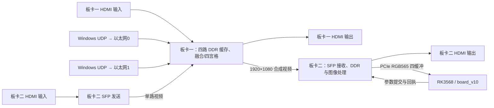

# FPGA 双板视频系统

两块紫光同创 FPGA 组成四路视频采集、融合/四宫格、光口互传与 PCIe 输出链路，RK3568 运行 [board_v10 ADAS 程序](../../board_v10/CURRENT.md)。板卡一已于 2026-10-29 更新为 2026-10-27 共用 LUT 构建；其他组件沿用 2026-10-26 仓库记录，版本与验证状态分别列明。

## 工程入口

| 组件 | 当前入口 | 作用 |
| --- | --- | --- |
| 板卡一 | [2026-10-27 共用 LUT 工程、bit 与说明](board1_capture/README.md) | 四路采集，三路 LUT 融合，KEY2 切换完整四宫格，缺 SFP 象限黑色，HDMI/SFP 输出 |
| 板卡二 | [2026-10-19 工程与协议](board2_sfp_pcie/README.md) | 本机 HDMI 经光口送板卡一；接收合成帧，DDR 后处理并输出 HDMI/PCIe |
| Windows 上位机 | [udp_video_sender](../../tools/udp_video_sender/README.md) | 视频、图片、彩条转 RGB565，以 UDP 送板卡一以太网输入 |
| RK3568 | [board_v10](../../board_v10/CURRENT.md) | PCIe read 采集、NPU 推理、图像参数控制和 ADAS 演示 |

两个 PDS 工程均使用 **PDS 2022.2-SP6.4，PGL50H / FBG484 / -6**。工程 ZIP、bit、FIC 和约束以各板说明为准，旧目录保留的协议不能直接当作当前接口。

## 数据链路

SFP 使用工程内自定义 8b/10b 视频协议。板卡二→板卡一传单路 HDMI，板卡一→板卡二传当前模式的合成帧；PCIe 接收的是一张合成视频，不是四个独立设备。

## 板卡一通道与 ADAS 画面

| DDR 通道 | 实际输入 | 四宫格位置 | 融合用途 | board_v10 默认解释 |
| --- | --- | --- | --- | --- |
| 0 | 板卡一 HDMI | 左上 | 左 | 前视 |
| 1 | 以太网1 | 右上 | 中 | 后视 |
| 2 | 以太网0 | 左下 | 右 | 左视 |
| 3 | 板卡二 HDMI 经 SFP 返回 | 右下 | 不参与 | 右视 |

实际接入的视频必须与应用语义相符。例如右上应送后视素材；不能仅按文件名认定相机方向。每路 960×540，四宫格合成 1920×1080。保留的 OV5640 模块当前未接入上述四路。

板卡一上电默认三路融合：1920×540 全景位于上半区，下半区黑色。**运行按象限分析的 board_v10 前，应按 KEY2 切换到完整四宫格。** KEY2 位于 L15、低电平按下；等待完整新结果生成后，HDMI 与 SFP 在垂直消隐期共同切换。四路页锁定保证单路完整帧，不等于相机曝光同步。

当前板卡一 LUT 由三组前左 / 前中 / 前右视频共同估计，三组共用一套 left/center/right 共 12 个 BRAM hex；每路相机仍有各自的坐标映射。保留固定 640/1280 接缝和 128 像素羽化，动态接缝已回退。当前融合素材对应 HDMI=前左、以太网1=前中广角、以太网0=前右；与上表 ADAS 象限语义不同，切换用途时应核对素材。

包含缺 SFP 切换修复：初始未收到 SFP 完整帧时，四宫格的其他三路仍更新，第四格黑色。融合仍需前三路完整帧。源有效状态为粘滞状态，已有画面后拔线可能保留末帧，不代表实时断线检测。

## 接线与启动顺序

1. 使用各板配套工程、约束和 IP 重建/准备位流，按对应验证说明检查；两块板的下载文件不能混用。
2. 两个方向分别连接：板卡一 TX→板卡二 RX，板卡二 TX→板卡一 RX；物理插座依 FDC 与板卡丝印核对。
3. HDMI 源接各自 HDMI IN；确认 DDR 初始化和 HDMI 画面，板卡一切到所需输出模式。
4. PC 千兆网卡接板卡一以太网口，配置本机 IPv4 和对应静态邻居，再启动 Windows 上位机发送彩条或视频。
5. 板卡二 PCIe 接兼容的 RK3568 RC 接口，确认枚举、驱动及读取权限，再按 [board_v10 启动说明](../../board_v10/CURRENT.md) 运行。

板卡二 SFP 使用工程中修改后的 PCIe IP 所提供的 `sfp_*`/fabric 接口，不能直接用原生成 IP 覆盖或另外实例化竞争相同 HSST 资源的收发器。

## 以太网参数

| 板卡一接口 | 目标 IPv4 | 目标 MAC | UDP 端口 |
| --- | --- | --- | --- |
| 以太网0 | `192.168.1.10` | `A0-B1-C2-D3-E4-E4` | `1234` |
| 以太网1 | `192.168.1.11` | `A0-B1-C2-D3-E1-E1` | `1234` |

当前 FPGA 输入按 **960×540 RGB565** 准备。上位机起始设置：10 FPS、120 Mbps、256 B 像素负载、20 μs 最小包间隔、2 ms VS 消隐。双路分别打开两个发送窗口。网卡地址、静态邻居配置及协议详见 [Windows 上位机](../../tools/udp_video_sender/README.md)。

## PCIe 与图像控制版本

当前板卡二包含五字参数提交、唯一 cookie、128 字节独立邮箱及 RECEIVED/APPLIED 两阶段回传。`board_v10/driver` 以 pcie_v3 8.0 为基线并包含 8.1 性能修改，匹配说明见 [图像参数控制](../../board_v10/docs/PCIE_V3_IMAGE_CONTROLS.md)。

[tools/pcie_v2](../../tools/pcie_v2/README.md) 保留的是驱动 7.0 单向参数提交查看器；它的“提交成功”不等于双阶段回执已确认。不要把视频 ABI 同为 2 视为图像参数协议完全一致。Qt 查看器和 ADAS 程序不能同时占用同一设备。

## 验证状态

| 部分 | 已有验证 | 仍需确认 |
| --- | --- | --- |
| 板卡一 2026-10-27 共用 LUT | 三组 RTL 通过，缺 SFP/恢复/模式切换仿真欠读 0；2026-10-29 哈希核对一致，用户确认本版上板可运行 | 物理时序未收敛；长期运行、环境变化及全部缺路场景仍需验证 |
| 板卡二 2026-10-19 | 9 项离线回归通过，215 个 PDS 输入齐全，归档完整性已检查 | 本次工程发布未重建/下载位流，不附 bit |
| board_v10 | 同步前 5 项板端回归、10 项 CPU 回归通过 | 应用检查不能替代真实 DMA、参数回执与整条链路验收 |

板卡一当前共用 LUT 构建：DDR Slow Setup −4.021 ns、Slow Hold −0.044 ns、Fast Hold −0.088 ns，像素 Slow Setup −0.865 ns。名义 HDMI 刷新约 60.606 Hz，不代表物理时序或新画面生成速率已获保证。详细日志分别见两块板 README。

更换相机、视角或裁剪要重新验证 LUT 和车道参数；融合 LUT 是针对当前测试视角离线估计，并非官方通用标定。第三方 IP 声明保留在工程包内，见 [权利通知](DISCLAIMER.md)。
