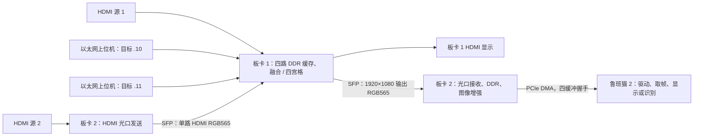

# 双板四路采集、三路融合、光口互传与 PCIe 输出

> 2026-10-24：板卡一已更新为 KEY2 切换三路融合 / 四宫格版本，[工程ZIP、调试bit与说明](board1_capture/README.md)。当前通道顺序为 HDMI、以太网1、以太网0、SFP；新集成 bit 尚待上板，物理时序未收敛。

> 2026-10-19：板卡二已替换为Logos PCIe包头兼容修正版，含最新FIC和两阶段回传；见[更新说明](board2_sfp_pcie/docs/PCIE_HEADER_KEEP_FIX.md)。以下较早版本记录保留为历史说明。

## 当前板卡二（2026-10-19）

[board2_sfp_pcie](board2_sfp_pcie/README.md) 已替换为最新`sfp_ddr_image_pice_handshake`，入口为[完整工程ZIP](board2_sfp_pcie/sfp_ddr_image_pice_handshake_20261019_header_keep_fix.zip)，解压后打开`hdmi_ddr_pice.pds`。完整DDR后图像处理、DRM优化、当前FIC和参数RECEIVED/APPLIED两阶段回传均包含在内。

请先读[代码解说](board2_sfp_pcie/docs/CODE_WALKTHROUGH.md)、[RC指南](board2_sfp_pcie/docs/RC_PCIE_CONTROL.md)及[两阶段回传接口](board2_sfp_pcie/docs/IMAGE_PARAMETER_ACK.md)。新增0x218登记128字节独立确认区，0x214提交唯一cookie；原四缓冲、STOP及PCIe/SFP生成IP保持原协议/源码。旧0x220/0x224接口不使用。ARM现有7.0单向驱动须另行适配，新工程不替换仓库的ARM、板卡一和以太网代码。

## 双板接线与板卡一现有配置

板卡一采用2026-10-24融合 / 四宫格按键切换版，板卡二采用2026-10-19更新版本。两块板卡均以ZIP保存PDS、RTL、IP和约束；板卡一另附最新调试bit，配套FIC在工程包中。以太网地址沿用原值，通道顺序已调整，见下表。

本快照上传至私有仓库，仅作项目内部备份、调试和回退。第三方材料的权利与许可不因
入库而改变；收到有效权利通知后将立即限制访问或删除。详见
[免责声明与权利通知](DISCLAIMER.md)。

## 工程入口

| 设备 | 工程 | 顶层 | 作用 |
| --- | --- | --- | --- |
| 板卡 1 | [工程ZIP](board1_capture/board1_fusion_quad_20261024.zip)，解压后 `3_ddr_test.pds` | `test_ddr`，`source/ddr_test_top.v` | 四路DDR缓存，KEY2切换三路融合 / 四宫格，HDMI与光口输出同一画面 |
| 板卡 2 | [板卡二工程ZIP](board2_sfp_pcie/sfp_ddr_image_pice_handshake_20261019_header_keep_fix.zip) | `hdmi_ddr_pcie`，`source/hdmi_ddr_pcie.v` | HDMI 经光口送给板卡 1；接收板卡 1 合成视频，经DDR、完整图像处理共同送HDMI和PCIe/鲁班猫2 |
| Windows PC | [以太网上位机](../../tools/udp_video_sender/README.md) | `app.py`，双击 `start.cmd` | 视频/图片/彩条转换为 RGB565，通过 UDP 送板卡 1 |

两个 PDS 文件记录的工具版本均为 **PDS 2022.2-SP6.4**，器件 **PGL50H / FBG484 / -6**。使用相应版本打开各自 PDS 文件，执行 Compile、Synthesize、布局布线、时序检查和 Generate Bitstream，再分别下载到对应板卡。

## 双向数据流



两个光口方向承担不同内容：板卡 2 发出的是自身 HDMI 输入；板卡 1 回传的是当前所选模式的单帧，外部尺寸均为 1920×1080。返回链路没有四个独立 PCIe 视频流。ARM 按象限切分时应选四宫格并核对新通道顺序；融合模式的上半区为 1920×540 全景，下半区黑色，需要应用按融合画面解释。光口使用工程内自定义 8b/10b 视频协议，不是光纤以太网或 UDP。

## 板卡 1 当前四路映射

每个象限为 960×540 RGB565，合成尺寸为 1920×1080。顶层参数 `ZOOM_VIDEO_LENGTH/ZOOM_VIDEO_HIGTH` 为 960/540，`VIDEO_LENGTH/VIDEO_HIGTH` 为 1920/1080。

| DDR 通道 | 当前输入 | 主要信号 | 显示位置 |
| --- | --- | --- | --- |
| 0 | 板卡 1 HDMI，经 `video_zoom` | `hdmi_ddr_de`、`hdmi_ddr_vs`、`zoom_data_out` | 左上；融合左路 |
| 1 | 以太网口 1 | `eth1_rx_de/vs/data` | 右上；融合中路 |
| 2 | 以太网口 0 | `eth0_rx_de/vs/data` | 左下；融合右路 |
| 3 | 板卡 2 HDMI 经 SFP 接收，再缩放 | `hdmi_sfp_ddr_de`、`hdmi_sfp_ddr_vs`、`zoom_sfp_data_out` | 右下；不参与融合 |

本地目录名包含 `ov5640`，工程也保留 OV5640 配置和采集模块；但是当前顶层通道 2 的 CMOS 接线被注释，通道 1 接以太网口 1，通道 3 接 SFP。因此当前快照是 **HDMI + SFP + 双以太网**。若需要 OV5640 作为一路输入，应另外调整顶层接线，不能仅按目录名判断已启用。

通道 0 和通道 3 的 HDMI / SFP 输入保留隔帧写入；对应 DE 与 VS 均使用当前取帧信号，通道 3 的 VS 为 `hdmi_sfp_ddr_vs`。隔帧降低平均流量，不降低保留帧内的瞬时像素速率。

KEY2（L15，低电平）使用原消抖模块，按一次切换输出模式。上电默认为前三路融合，原 128 像素过渡，1920×540 显示在上半区；按键后等待完整新结果，在垂直消隐期切换，HDMI 与 SFP 同时生效。再次按下返回融合。
HDMI 名义刷新约 60.606Hz，新融合结果的生成速率受渲染限制；四路源页锁定不等于四路曝光同步。LUT 仅对应当前测试视角，并非官方通用标定。


## 接线与启动顺序

1. 板卡 1、板卡 2 分别下载对应工程生成的位流，确认 DDR 初始化成功。两个原工程的下载文件不能混用。
2. 两块板卡的 SFP 建立双向连接：板卡 1 TX 接板卡 2 RX，板卡 2 TX 接板卡 1 RX。当前顶层使用 `i_p_l2rx* / o_p_l2tx*`，具体物理插座按各自 FDC 和板卡丝印核对。
3. HDMI 源分别连接两块板卡的 HDMI IN。板卡 1 HDMI OUT 可检查融合或四宫格；需要四路独立画面时按 KEY2 切到四宫格。
4. 电脑千兆网卡接板卡 1 对应以太网口，按下节设置静态邻居映射，再运行上位机。
5. 板卡 2 PCIe 接鲁班猫 2 的兼容 RC 接口。先确认 PCIe 枚举，再加载与四缓冲握手协议匹配的驱动，登记 DMA 缓冲并启动取帧。

板卡 2 的 SFP 物理收发器已经接入修改后的 PCIe IP：`source/hdmi_ddr_pcie.v` 使用 `pcie_test` 的 `sfp_*` 端口，SFP 编解码模块使用其 fabric 接口。不能直接用原始 PCIe IP 覆盖本目录的修改版，也不能额外实例化一个竞争同一物理 HSST 资源的收发器。保留两端 IP 配置、字对齐和 K 码协议一致。

## 以太网发送参数

| 板卡 1 接口 | 目标 IPv4 | 目标 MAC | 默认 UDP 目标端口 |
| --- | --- | --- | --- |
| 以太网 0 / DDR 通道 2 | `192.168.1.10` | `A0-B1-C2-D3-E4-E4` | `1234` |
| 以太网 1 / DDR 通道 1 | `192.168.1.11` | `A0-B1-C2-D3-E1-E1` | `1234` |

最新版上位机支持本机 IP 下拉/手填与刷新、目标 IP/MAC 设置、输入/输出分辨率和帧率、帧头到尺寸包的 VS 消隐间隔、UDP 像素负载和包间隔。对当前 FPGA，**输出仍设为 960×540**；输入视频可以是其他分辨率，上位机会缩放。改界面输出尺寸不会自动改 FPGA。

在 `tools/udp_video_sender` 的管理员 PowerShell 中执行，示例本机地址为已配置到相应网卡的 `192.168.1.102`：

```powershell
powershell -NoProfile -ExecutionPolicy Bypass -File .\configure_network.ps1 -LocalIP 192.168.1.102 -TargetIP 192.168.1.10 -TargetMAC A0-B1-C2-D3-E4-E4
```

第二路使用 `.11 / A0-B1-C2-D3-E1-E1`，`LocalIP` 选择实际连接该口的网卡地址。两个独立直连网卡若配置在同一子网，需要确认 Windows 路由选择正确；本程序绑定源 IP，不能把静态 ARP 当成路由配置。也可在合适的千兆交换网络中，用同一网卡向两个不同目标发包。

双击 `start.cmd`，首次启动安装 Python 依赖。单个窗口同时只发送一个目标；双路测试运行两个窗口，分别填写两组目标。建议先用 960×540、10 fps、120 Mbps、256 B 像素负载、20 us 最小包间隔、2 ms VS 消隐验证，再根据 DDR/FIFO 波形调整。两窗口会共同占用主机和网络资源。

每帧的 UDP 负载顺序：`F0 5A A5 0F` 帧头包 → 等待 VS 消隐 → `03 C0 02 1C` 尺寸包 → 恰好 1,036,800 字节大端 RGB565 像素。停止会发送完当前帧；无 ACK、包序号和重传，本地显示已提交不等于 FPGA 确认接收。

## 板卡 2 到鲁班猫 2

板卡二接收SFP原始RGB565写DDR，恢复时序后经 `image_processing_top`，处理后的公共输出分别送HDMI和 `pcie_dma_ctrl`。后者同时管理图像参数与四缓冲DMA，默认1080p RGB565、64字节图像payload、64800个图像包。

RC执行地址登记 → START → 等待完整帧尾token → 消费 → RELEASE(token)；四槽未归还则跳帧。STOP(cookie)等待独立停止状态区应答。完整寄存器、端序、图像五字配置和适配示例见 [RC控制指南](board2_sfp_pcie/docs/RC_PCIE_CONTROL.md)。启用新0x218接口后，参数已接收和已生效分别返回到独立128字节图像确认区；STOP cookie仍只代表原DMA排空。

仓库已有 [board_v8 PCIe 实时输入说明](../../board_v8/PCIE_INPUT.md)，应用把左上/右上/左下/右下解释为前/后/左/右。实际视频接线应与这个语义一致；当前板卡一默认输出融合，现有应用按四路象限解析时需切到四宫格并适配 HDMI / 以太网1 / 以太网0 / SFP 的顺序。**board_v8 依赖 HS2 ioctl 驱动；仓库原 `tools/pcie_hdmi_host_system/driver` 是较早版本，不能默认认为 ABI 匹配。** 本次整合没有替换鲁班猫内核驱动，也不宣称下载后即可完成整个识别链路。

## 版本与验证范围

- 板卡一已替换为2026-10-24版工程ZIP和最新调试bit，原源码由Git历史保留；Windows以太网上位机和板卡二保持当前版本。
- 板卡二来自 `sfp_ddr_image_pice_handshake`，原IP及算法按字节复制；新增代码解说、RC操作指南和来源/完整哈希清单。
- 板卡二PDS设计输入214个均存在；20261017版通过7项RTL仿真和2项C99测试，本次未重新运行PDS综合/映射或位流生成。验证结果见 [代码解说](board2_sfp_pcie/docs/CODE_WALKTHROUGH.md)，当前详细日志位于工程ZIP内的 `docs/verification/20261017/image_ack`，合并验证记录为 `docs/PCIE_CONTROL_MERGE_VALIDATION.md`。
- 板卡一已完成综合、布局布线和bit生成，按键/四宫格/完整切换仿真通过，欠读0；物理时序未收敛（DDR Slow Setup −3.606ns、最差Hold −0.172ns，SFP输入缩放像素路径Slow Setup −2.107ns），本次新集成版尚未上板。工程ZIP附匹配bit/FIC，排除旧位流和编译缓存。
- 板卡二仍以其独立说明中的验证边界为准，未因本次板卡一更新重新构建或进行双板/鲁班猫板上验收。
- 老版本由Git历史保留；20261011日期目录只有迁移说明，避免把旧的独立配置状态页协议用于当前版本。

第三方IP和例程的版权/授权声明保留原样。
