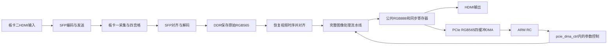

> 当前工程：[主工程ZIP](../sfp_ddr_image_pice_handshake_20261019_header_keep_fix.zip)、[PCIe仿真库ZIP](../sfp_ddr_image_pice_handshake_20261019_pcie_sim.zip)。两包解压到同一父目录，合并同名工程文件夹；下述源码路径相对工程根目录。

> 2026-10-19 最新源码快照：已修复 Logos PCIe IP 的3DW包头 `tkeep=1111` 被图像命令过滤的问题。图像写入仍要求单DW数据拍 `tkeep=0001`，视频DMA原有解析条件不变。参数接收、生效和回传通过9项离线回归；此发布未运行PDS位流构建或硬件下载，不附带位流。需要自行重建匹配位流。当前FIC为 `IMAGE_ACK_RX_APPLIED_TX_20261017`，Core0端口133/161位，Core1端口244/245位，均256点。下方较早记录保留为历史说明。

# 板卡二代码解说：SFP、DDR、图像处理与PCIe DMA


本文对应2026-10-17的 `sfp_ddr_image_pice_handshake`，工程入口为 hdmi_ddr_pice.pds（`hdmi_ddr_pice.pds`），器件PGL50H / FBG484 / -6，工具PDS 2022.2-SP6.4。

当前版本的图像参数接收、暂存和提交逻辑已经合入手写 pcie_dma_ctrl.v（`source/source/pcie_dma_ctrl.v`）。顶层只有一个PCIe应用控制器，不再有独立 `pcie_image_control` 模块；SFP、PCIe的IP核及IP生成文件保持来源工程原样。

配套阅读：[RC控制PCIe指南](RC_PCIE_CONTROL.md)、当前整合说明（`docs/PCIE_IMAGE_INTEGRATION.md`）、合并验证记录（`docs/PCIE_CONTROL_MERGE_VALIDATION.md`）。

## 1. 先看两条视频方向

板卡二自身HDMI输入经过SFP发给板卡一，供板卡一拼接；板卡一返回的合成视频经过另一方向进入板卡二，写DDR后处理，再共同送到HDMI和PCIe。



处理模块位于DDR读侧，DDR保存的是SFP收到的原始RGB565。四个PCIe缓冲轮换承载同一条视频流，不是四路独立视频。若输入是四宫格，当前算法参数对整张合成图生效，不提供逐象限独立配置。

## 2. 推荐阅读顺序

| 文件 | 阅读重点 |
|---|---|
| source/hdmi_ddr_pcie.v（`source/hdmi_ddr_pcie.v`） | 所有模块的实际接线，视频处理入口、公共输出和控制总线 |
| source/sfp_8b10b_top/sfp_8b10b_top.v（`source/sfp_8b10b_top/sfp_8b10b_top.v`） | SFP发送编码、接收对齐和解码的组织 |
| source/ddr3_ctrl_top.v（`source/ddr3_ctrl_top.v`） | 像素侧FIFO与DDR AXI控制连接 |
| source/source/sync_generator.v（`source/source/sync_generator.v`） | 本地恢复的VS、HS、DE和有效区计数 |
| source/src/img/image_processing_top.v（`source/src/img/image_processing_top.v`） | 整包参数的帧锁存、DCP分支与后级串联 |
| source/src/img/rgb_enhancement_pipeline.v（`source/src/img/rgb_enhancement_pipeline.v`） | 共用颜色转换、降噪/Gamma/CLAHE/亮度曲线/高光保护 |
| source/source/pcie_dma_ctrl.v（`source/source/pcie_dma_ctrl.v`） | RC命令、图像配置跨域、四缓冲所有权和TLP发送 |

PDS中还有旧 `video_enhance.v/rgb2yuv.v/yuv2rgb.v` 文件，它们保留为来源资料，当前顶层没有再例化旧 `video_enhance`。判断实际功能应沿顶层例化追踪，不能只看目录里有哪些文件。

## 3. 顶层的时钟和复位

| 时钟/信号 | 用途 |
|---|---|
| `ref_clk` | 板上参考时钟，供PLL、DDR和PCIe相关逻辑使用 |
| `pix_clk_in` | 板卡二HDMI输入时钟，用于发送方向采集 |
| `pix_clk_out` | 本地PLL输出，供SFP解码读侧、DDR读侧、恢复时序和图像流水线使用 |
| `ddr_ip_clk` | DDR用户AXI时钟 |
| `pclk_div2` | PCIe应用逻辑时钟，RC命令解析和DMA发送运行在此域 |
| `sfp_tx_user_clk/sfp_rx_user_clk` | PCIe包装内HSST输出的SFP用户时钟 |
| `s_pclk_div2_rstn` | 同步到PCIe应用时钟域的核复位，驱动 `pcie_dma_ctrl.rstn` |

实际PLL输出频率以工程IP参数为准，不能仅凭注释里的“148.5MHz”推断最终位流频率。默认恢复时序为1920×1080，行总周期2200、帧总行数1125。

图像侧 `image_reset_async_n` 要求板复位释放、PLL锁定、DDR初始化、`fram_done` 和PCIe应用复位均有效。它经过像素域同步，再等待恢复视频的VS消隐区，才置位 `image_frame_ready` 并释放 `image_rst_n`，避免从半帧开始处理。

图像参数源状态跟随PCIe DMA复位。仅像素链路复位时，DMA内通过 `image_ready` 检测恢复，保留最近一次已提交快照并重送；PCIe核复位后，RC需要重新登记DMA缓冲并重新发送图像配置。

## 4. SFP发送和接收

顶层把HDMI RGB888按 `{R[7:3],G[7:2],B[7:3]}` 截成RGB565送给 `sfp_8b10b_top`。发送方向使用自定义视频控制字和8b/10b控制字符，接收方向经过 `sfp_data_align`、`sfp_decode` 恢复帧标志、有效像素和RGB565。

这条光口不是以太网UDP。对端须使用一致的控制字、K字符、字节对齐和视频节奏；以太网上位机数据只在板卡一对应以太网接口进入系统。

当前顶层实际使用Lane2的SFP接口，保留的Lane3发送端口固定无效。SFP物理接口经 `pcie_test` 包装的 `sfp_*` 端口连接共享HSST，不能另例化一个占用同一物理资源的收发器。

接收解码输出：

- `post_frame_vsync`：接收方向帧同步/复位标志。
- `post_frame_de`：接收像素有效。
- `post_rgb[15:0]`：原始RGB565像素。

这三个信号直接进入DDR写侧。本次整合和控制合并没有改变SFP协议、解码源码或相关IP。

## 5. DDR读写与恢复时序

`ddr3_ctrl_top` 内部由 `rw_fifo_ctrl` 和 `AXI_FULL_M` 配合：

1. 写FIFO在视频时钟侧收集16位像素，转换为256位数据供DDR突发写入。
2. AXI控制器管理DDR读写地址与突发请求。
3. 读FIFO把256位DDR返回数据转换为16位像素。
4. 本地 `sync_generator` 产生 `vs_o/hs_o/de_o`，原 `de_o` 继续驱动DDR读FIFO读使能。

工程实际使用 `source/read_ddr_fifo` 的256→16配置，不能误用同名旧IP目录推断位宽或延迟。它的同步RAM输出配置为 `OUTPUT_REG=0`，读响应有一拍时钟关系。

因此顶层把 `vs_o/hs_o/de_o` 先寄存为 `ddr_stream_*`，与读出的 `video_data_out` 对齐，再统一寄存为 `image_stage_*` 进入图像核心。读使能本身不跟着后级流水线延迟。

RGB565扩展保持原工程的低位补零：

```verilog
{video_data_out[15:11],3'b0,
 video_data_out[10:5], 2'b0,
 video_data_out[4:0],  3'b0}
```

恢复视频VS高有效，而图像核心VS低有效，所以入口使用 `~ddr_stream_vs`，输出再恢复极性。核心检测的VS下降沿，对应恢复视频开始帧消隐的上升沿。

## 6. 完整图像流水线

| 顺序 | 模块/阶段 | 功能与开关 |
|---|---|---|
| 1 | `dcp_rgb` | RGB域暗通道去雾，使用大气光时间平滑、天空保护，可选透射率双边滤波 |
| 2 | `VIP_RGB888_YCbCr444` | 一次RGB→YCbCr转换，为后续Y处理共用 |
| 3 | `bilateral_ycbcr` | Gamma和CLAHE之前的Y双边降噪，保留对应Cb/Cr |
| 4 | `gamma_table` | 对Y使用原固定Gamma LUT；本版没有运行时Gamma指数寄存器 |
| 5 | `clahe_luma` | 分块亮度直方图、裁剪、CDF及插值，配合强度和保护参数 |
| 6 | `legacy_tone_luma` | 原暗光增强与原高光压制，共用上述颜色转换 |
| 7 | `highlight_luma` | 独立的高光保护，使用knee、slope等参数 |
| 8 | `ycbcr2rgb` | 一次YCbCr→RGB恢复 |

各阶段旁路与处理结果保持固定延迟。`frame_config_delay` 让整包参数跟随对应帧到达后级，`video_stream_delay/video_line_delay` 对齐原图、色度和同步。

原暗光/高光曲线在 legacy_tone_luma.v（`source/src/img/legacy_tone_luma.v`） 内：

```text
lift   = dark_en  && Y <= dark_threshold  ? (dark_threshold - Y) >> 3 : 0
reduce = light_en && Y >= light_threshold ? (Y - light_threshold) >> 3 : 0
Yout   = clamp(Y + lift - reduce, 0, 255)
```

第一拍计算与保存差值，第二拍加减并饱和。每路最多改变31级Y；两路可以同时开启。它们与后面的soft-knee高光保护是独立功能。

当所有实际增强功能关闭时，流水线选择延迟后的原RGB，避免颜色空间往返量化影响“原图旁路”。天空保护、防光晕、阴影保护等辅助位默认置1，不会单独开启其所属主算法。

默认行总周期为2200，DCP和增强两大段各2248拍，核心共4496拍。加上DDR同步读响应、统一入口寄存和公共输出寄存，按下游采样口径为4499级流水。HS通过两段与核心等长的行RAM延迟，不能直接拿处理前HS配处理后RGB。

## 7. HDMI和PCIe为什么来自同一图像

顶层把 `image_output_rgb`、处理后的VS/DE和延迟后的HS一同寄存为 `r_out/g_out/b_out/vs_out/hs_out/de_out`。

HDMI使用这组RGB888和同步；`pcie_dma_ctrl` 的视频输入也使用同一组寄存器，重新截成RGB565：

```verilog
.hdmi_data_in ({r_out[7:3],g_out[7:2],b_out[7:3]}),
.vs_in        (vs_out),
.de_in        (de_out)
```

因此两路处理参数和帧时序一致。PCIe保持原RGB565格式，会舍弃RGB888的低位，不能要求ARM端RGB888重建值与HDMI的24位结果逐位相等。

## 8. PCIe应用控制器的接收逻辑

`pcie_dma_ctrl` 共用一套RX状态机：

| 状态 | 行为 |
|---|---|
| `RX_HEADER` | 检查MWr32类型、1 DW长度、BAR1、字节使能、地址对齐，保存偏移 |
| `RX_PAYLOAD` | 接收末拍payload，用 `endian32()` 得到逻辑命令值，再分发各寄存器 |
| `RX_DROP` | 丢弃不支持或不完整的包，直到TLAST再恢复解析 |

原DMA命令接收条件保持原样。图像命令额外利用 `image_rx_header_valid` 和 `image_write_valid` 检查头部keep恰好为7、payload keep恰好为1。

接收命令分成两组：DMA地址与所有权命令为 `0x110~0x1A0` 中已定义的偏移；图像五字配置为 `0x200~0x214`。原 `0x140/0x150/0x160` 在更新旧输出寄存器的同时，直接更新图像配置快照。

## 9. 五字配置如何安全进入像素域

`pcie_dma_ctrl` 内有四组不同用途的配置存储：

| 寄存器 | 含义 |
|---|---|
| `image_shadow_config` | RC逐字编辑的暂存区，单独写入不会立即生效 |
| `image_queued_config` | 下一份待发送完整快照；快速连续提交时保留最新一份 |
| `image_cfg_data` | 当前跨域发送的保持总线，等待ACK期间不变 |
| `image_committed_config` | 最近一次提交快照，用于像素链路复位后的自动重送 |

提交后，源域翻转 `image_cfg_apply`。像素侧 `image_runtime_control` 同步翻转位，等待总线稳定，钳位参数并暂存；到帧边界统一更新 `cfg_active` 和ACK。ACK经过两拍同步回 `pclk_div2`，源域才能复用跨域总线。

这种握手避免160位参数各位独立同步造成的混包。在途配置之外只有一个待处理槽，连续调参会合并中间请求；最后一次完整设置保留，但不保证每次提交都单独显示一帧。

## 10. 视频DMA的四缓冲与发送状态机

每个槽状态为：

```text
FREE → VS预留 → WRITING → 完成帧尾TLP → HELD → RC RELEASE(token) → FREE
```

VS上升时选择FREE槽、分配token；VS下降后允许采集。没有空闲槽、上一包未结束或当前帧异常时跳过整帧。HELD槽不会自动轮转覆盖，软件归还必须匹配完整token。

像素域FIFO收集处理后的RGB565；PCIe时钟域每次取四个128位数据字，拼成512位、64字节payload：

| 状态 | 行为 |
|---|---|
| `TX_WAIT` | 优先STOP，再发图像参数RECEIVED/APPLIED，最后按原路径发图像包或帧尾 |
| `TX_FETCH_REQUEST/WAIT/CAPTURE` | 按FIFO读延迟取四个128位字 |
| `TX_HEADER` | 呈现MWr32头，等待VALID/READY握手 |
| `TX_DATA` | 发送四拍128位payload，最后一拍TLAST |

只有VALID与READY同时有效才前进。背压期间保持数据、VALID和TLAST；VS/STOP到来时也要完成已经呈现的TLP，不能直接截断包。

默认一帧图像有64800个64字节包，之后再发送64字节完成标记。完成标记内重复16次32位token；独立STOP状态区重复16次本次cookie。详细内存布局、端序和软件归还顺序见配套RC指南。

## 11. 哪些文件适合改，哪些应保持成套

业务接线在 `source/hdmi_ddr_pcie.v`，DMA应用层和寄存器协议在 `source/source/pcie_dma_ctrl.v`，图像算法在 `source/src/img` 与 `source/src/common`。

`ipcore` 以及 `source/read_ddr_fifo/source/write_ddr_fifo` 中的IP生成文件，与其IDF、约束和厂商模型成套使用。本版没有改动它们，也没有把图像控制塞进IP生成的包装文件。

本版在手写DMA控制器中新增PK_IMAGE_ACK包类型，与原64字节MWr共用TX状态机。回传包不推进图像地址或计数；STOP排空并禁用回传区。FIFO例化、PCIe/SFP生成IP、原帧token与STOP区格式保持不变。PDS当前引用debug/image_pcie_debug.fic；行缓存沿用2048+152分银行的DRM优化，见 [DRM与入口调试](DRM_REDUCTION_AND_PCIE_IMAGE_DEBUG.md)。

## 12. 验证和阅读时的边界

当前2026-10-17回传版通过7项RTL仿真（含完整1080p、DDR后整机、新回传随机背压）及2项C99参考接口测试。历史合并/DRM/插核版本的PDS记录仍在验证目录，但本次新增回传没有重新运行PDS综合/映射，不能把旧资源或时序统计当成当前结果。

这些记录不等同于布局布线后时序签核或板上画质验收。当前源码没有对应本次重建的新bitstream，仓库这一版不提供旧生成位流作为下载文件。恢复后从本目录PDS重新构建、检查约束和时序，再下载联调。

建议依次确认：SFP恢复流 → DDR原图 → 全关旁路 → HDMI与PCIe一致性 → 单独暗光/高光 → DCP/Gamma/CLAHE组合 → RC长期持有、乱序归还和STOP。各问题对应的信号与软件检查见 [RC指南](RC_PCIE_CONTROL.md)。

## 13. ARM参数回传如何接入原控制器

`CMD_IMAGE_ACK_ADDR=0x218`只在原图像/STOP地址已配置、DMA停止且TX空闲时登记128字节确认区；地址检查覆盖整个范围、32位溢出以及与四块图像/STOP区的重叠。

`image_rx_word_mask[4:0]`记录五字接收，WORD0开始新包。收齐并接受带唯一cookie的COMMIT后，更新`image_received_cookie`，排队发送RECEIVED。cookie随`image_queued_config`进入在途快照；只有对应像素帧ACK返回，才更新`image_applied_cookie`并发送APPLIED。像素复位不能伪造生效确认。

两种回包都复用原64字节MWr头和四拍128位数据发送，payload重复16次endian32(cookie)，目的地址分别为确认区基址和基址+64。回传TLP一旦呈现，就算遇到VS、背压或STOP也须完整发送；原STOP仍优先并在此前TLP排空后回写自己的cookie。每个ARM图像请求串行等待两个回复，避免中间待处理快照被合并。

参数收到确认与参数生效确认的详细定义、ARM适配、超时/STOP重绑定、参考函数及验证日志见 [两阶段协议](IMAGE_PARAMETER_ACK.md)。现有`tools/pcie_v2`需按该契约扩展；本次没有替换其驱动、Qt或视频ABI。
